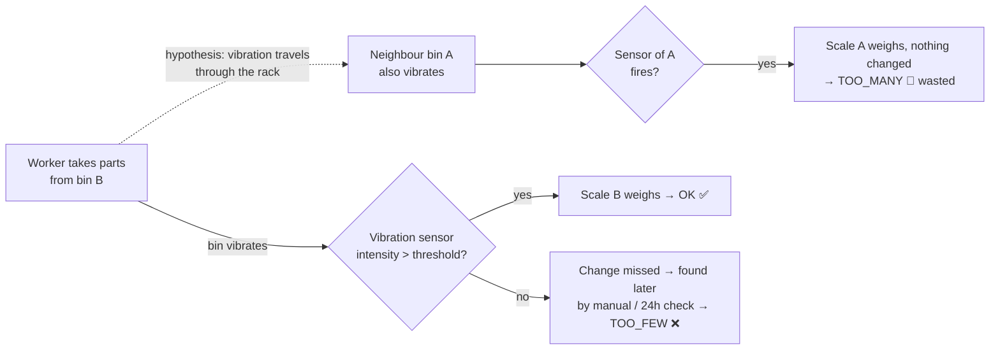
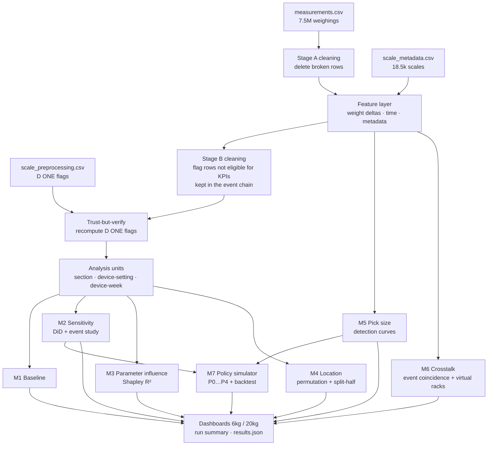
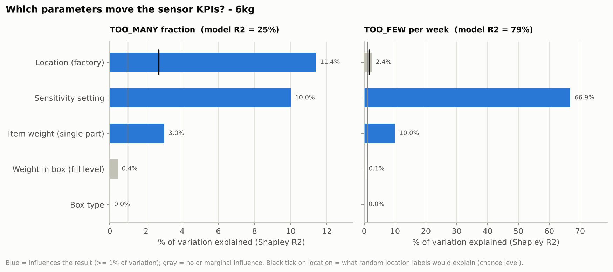
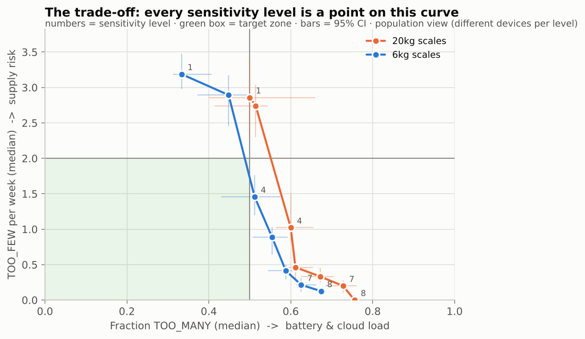
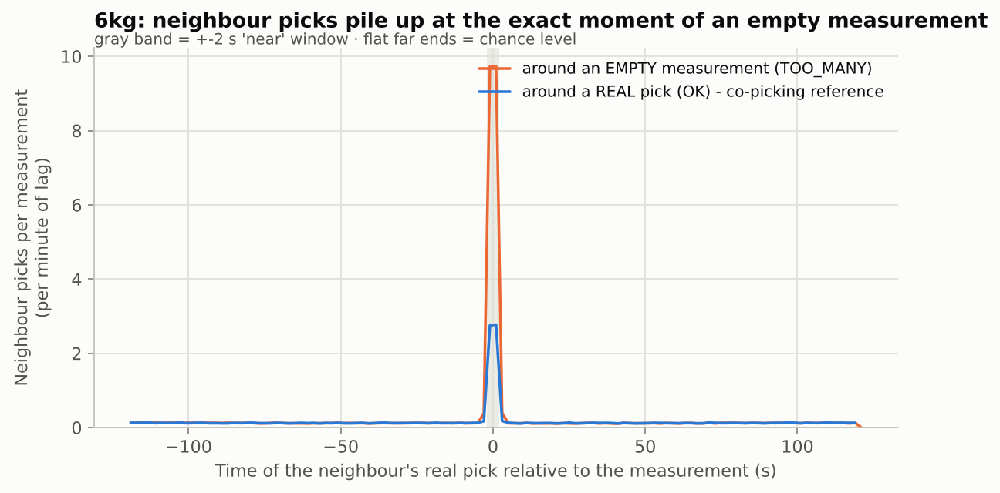
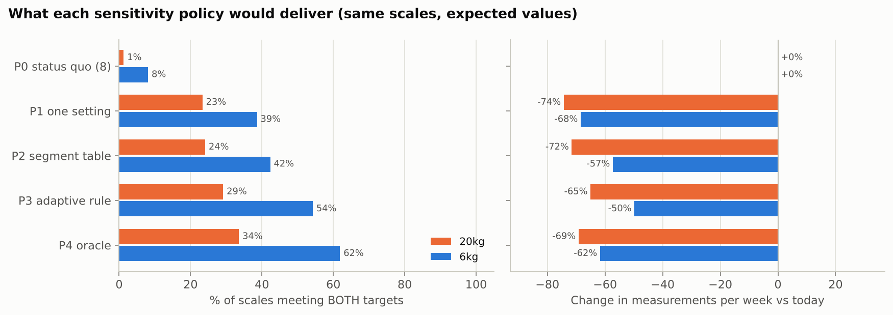

# SmartBin Cloud: data-driven tuning of an IoT vibration sensor

**What this repo does.** It finds the sensitivity setting that stops 110,000 battery-powered smart bins from weighing themselves for nothing, without letting real stock changes slip through.
**How.** It answers the question with causal inference on 7.5 million IoT events. Every method is validated against a simulator with a planted ground truth before it touches real data.

> Case from the HSLU MSc *Data-Driven Supply Chain Management & Logistics* module (Bossard AG × D ONE).
> The confidential fleet data is **not** included. `make demo` runs the full pipeline on a realistic synthetic fleet instead.
>
> **Status: interim findings (presentation 23 Oct 2026).** Pipeline, written report and both decks (CTO deck and long deck) are complete; the Power BI report is built on top of the pipeline output.

## The answer in one paragraph

The right sensitivity is not in the master data: box type and item weight matter little next to site and usage, and how busy a bin is, what happens on the rack next to it and how small its picks are only show once the scale runs. So every scale learns its level from its own weekly KPIs – **flag, tune, watch**:

| Part | What | Effect in the data / simulation |
|---|---|---|
| **Flag** | daily trigger-loop detector, looping scales to service, level 3 off the menu | 1.5% of the scales caused 27% of all automatic weighings (mostly during the April trial of level 3) |
| **Tune** | start on level 7; every two weeks one step less sensitive if > 7 empty wake-ups a week and ≤ 5% missed, one step more sensitive if > 10% missed or > 2 TOO_FEW a week; 6 kg and 20 kg monitored apart | −61% (20 kg) / −55% (6 kg) weighings, median missed changes 11–12% |
| **Watch** | KPI 2.0 per scale, the 24 h idle check as safety net, a watch list for the few scales where misses concentrate, an alarm for scales without a weighing for 48 h | misses found after a median of 33–38 h, 76–83% within 48 h; no nightly check for every scale |

Key insight: once the looping scales are left out, 55% of the empty wake-ups coincide with a real pick at another bin of the same site within ±14 s (beyond chance; a placebo site gives 0.7%). Every key result holds without the looping scales (`report/robustness_loops.py`, report Appendix C).

Rejected after testing: one level for all, a table by pick size, steering by the TOO_MANY fraction, quiet hours, a longer minimum wait time (not measurable). Merging bursts of wake-ups is an optional firmware item.

---

## The problem in one picture



A measurement draws about **3000×** the sleep power. Each one also travels over the radio network and loads the IoT cloud.
The **sensitivity (1–10)** setting decides when the sensor fires:

| Too sensitive (R1) | Correct (R2) | Too insensitive (R3) |
|---|---|---|
| many empty measurements → battery, cloud load | only real changes are measured | changes are missed → stock-outs at the customer |
| KPI: fraction TOO_MANY **> 0.5** | both targets met | KPI: TOO_FEW **> 2 per week** |

**Three questions to answer:**
1. Which parameters have no or only marginal influence?
2. Which parameters do influence the result?
3. How should the sensitivity be set?

---

## Approach (CRISP-DM)



| Module | Business question | Method | Why this method |
|---|---|---|---|
| **M1 Baseline** | How many scales meet the targets today? | KPIs per scale at the factory default (8) | Shows the size of the gap before any recommendation |
| **M2 Sensitivity** | What does the knob *really* do? | Same scale before/after a switch, minus the trend of scales that stayed on 8 (**difference-in-differences**). Rates use a **fixed-effects Poisson** rate ratio. **Event study** for the picture | Levels were not assigned at random, so comparing different scales is confounded (sensitivity 3 shows it) |
| **M3 Parameter influence** | Which parameters matter, and how much? | Main view: spread between the best and worst group per parameter. Appendix: **Shapley decomposition of R²** (LMG) with a permutation noise floor | The spread is easy to read; Shapley splits explained variance fairly between correlated parameters, but "variance explained" is not "strength of the knob" (decision 20) |
| **M4 Location** | Is the factory effect real? | ICC, **permutation test** (999 shuffles), **split-half reliability** | Answers "significant?" without distributional assumptions; split-half is understandable for managers |
| **M5 Pick size** | Below how many grams does a pick go unnoticed? | Weight drop between consecutive weighings → detection curve per level, logistic **D90** | Turns item weight into an actionable threshold |
| **M6 Crosstalk** | Do neighbours trigger each other? | **Event-coincidence analysis** (cross-correlogram, chance-corrected), root-cause split, **virtual racks** by community detection | The metadata only knows the site. Timing reveals which bins are physically close |
| **M7 Recommendation** | Which policy, and what does it buy? | Counterfactual simulator: each scale's own history × causal rate ratios. Policies P0–P4 incl. an **adaptive feedback rule**. **Backtest** on real switchers | A rule people can understand and audit, not a black box (Bossard's own Smart-Ordering lesson) |
| **M0 Validation** | Do the methods find what is really there? | Pipeline run on a simulator with planted effects (null effect for box type, crosstalk, selection bias…) | We trust a method on real data only after it passes on known truth |

---

## Outputs (synthetic demo, numbers are NOT Bossard's)

| | |
|---|---|
|  |  |
| **Which parameters matter**: share of variation explained, chance-corrected | **The trade-off**: every sensitivity level is a point on the curve |
|  |  |
| **Crosstalk**: neighbour picks pile up exactly at empty measurements | **Policies**: share of scales in target vs measurement savings |

Each run produces:
- `reports/index.html`: cleaning funnel, data checks, column decisions, validation.
- `reports/dashboard_6kg.html` and `reports/dashboard_20kg.html`: the full storyline per scale type.
- `reports/run_summary.md`: the answers in plain text.
- `reports/results.json`: every headline number.
- `reports/tables/*.csv`: every table.
- `reports/powerbi/`: analysis-ready tables for the Power BI report (one row = one scale on one sensitivity level) + column dictionary.
- `data/processed/filtered_out/`: every row that did not enter the KPI analysis, with the reason (sample per reason, all duplicate copies, deleted rows).

---

## Run it

```bash
pip install -e ".[dev]"     # Python >= 3.10
make demo                   # synthetic fleet -> reports/demo/index.html  (~1 min)
make test                   # unit tests + end-to-end recovery test
```

On the real data, put the three files into `data/raw/` and run:

```bash
make smoke                  # 1 min: proves the code reads the real format (10 MB random-row sample)
make run                    # full 7.5M rows -> reports/  (a few minutes, DuckDB on disk, laptop-friendly)
```

Shortcut when the three Bossard files sit **one folder above** the repo:

```bash
bash run_bossard.sh                                   # macOS / Linux
powershell -ExecutionPolicy Bypass -File run_bossard.ps1   # Windows
```

## Report and presentation

- `report/report.pdf` – the written report (Quarto with the Typst engine, 18 pages).
- `presentation/SmartBin – CTO presentation.pptx` – the deck for the client's CTO: problem, findings, flag-tune-watch, result, next steps (18 slides + 6 backup), plain language, charts instead of text, short speaker notes. Dark theme with DM Sans and Space Grotesk (free Google fonts).
- `presentation/SmartBin – the story for the client.pptx` – the long deck: 19 slides plus appendix and references, with speaker notes.
- Power BI: `docs/07_powerbi_dashboards.md` describes the three report pages (data, DAX measures, visuals) and which CTO slide each one can replace. The long deck still has placeholder slides for them.

After a full pipeline run both are rebuilt with:

```bash
python report/build_figures.py --reports reports/bossard --processed data/processed --db data/interim/smartbin.duckdb
python report/robustness_loops.py --db data/interim/smartbin.duckdb --parts knob,policy,coupling,extra,bins,examples
quarto render report/report.qmd
python presentation/build_deck.py
python presentation/build_cto_deck.py
```

`report/data/` holds only aggregated tables, `report/figures/`, `presentation/charts/` and `presentation/charts_cto/` the charts. `--figures-only` redraws the report charts without the raw data; both decks need only `report/data/` (long deck fonts: Inter and Source Serif 4; CTO deck: DM Sans and Space Grotesk).

Every analytical choice lives in `config/config.yaml`: targets, filters, windows, battery assumptions. No numbers are hard-coded.

## Repository

```
config/config.yaml          all assumptions & thresholds
src/smartbin/
  io.py  cleaning.py  features.py  tables.py  kpi.py  stats.py  viz.py  report.py  pipeline.py
  powerbi.py                Power BI pack (per-scale tables)  ·  explorer.py  interactive pick-size page
  analysis/  baseline · sensitivity · importance · location · pick_size · crosstalk · policy · validation
  simulate.py               synthetic fleet with known ground truth
docs/                       problem & KPIs · data dictionary · cleaning rules · methodology · decision log · report notes ·
                            Power BI dashboard guide
report/                     written report: build_figures.py (aggregates + charts), robustness_loops.py (results without
                            the looping scales, placebo test, examples), report.qmd, report.pdf
presentation/               build_cto_deck.py (CTO deck), build_deck.py (long deck), charts, the two .pptx
tests/                      KPI / stats / cleaning unit tests + end-to-end recovery test
```

## Limitations (stated, not hidden)

- **Observational data.** The before/after design removes everything that is constant per scale, and the stayer trend removes calendar effects. It cannot rule out a change that happened *only* to switchers at the moment of their switch.
- **TOO_FEW is a lower bound of the misses.** Only a manual / 24 h check can produce it; a missed pick followed by an automatic weighing is labelled OK.
- **TOO_FEW can bundle several missed picks**, which biases the detection curves in two opposite directions: fewer misses are counted, but they appear at larger pick sizes.
- **Location = site.** No rack positions exist in the data; virtual racks are inferred and should be confirmed on site.
- **The battery effect is a model.** A measurement is assumed to take 2 s at 3000× sleep power; this is a config value with a sensitivity check.

Docs: [problem & KPIs](docs/01_problem_and_kpis.md) · [data dictionary](docs/02_data_dictionary.md) · [cleaning](docs/03_data_cleaning.md) · [methodology](docs/04_methodology.md) · [decision log](docs/05_decision_log.md) · [report notes](docs/06_report_notes.md) · [Power BI dashboards](docs/07_powerbi_dashboards.md)
