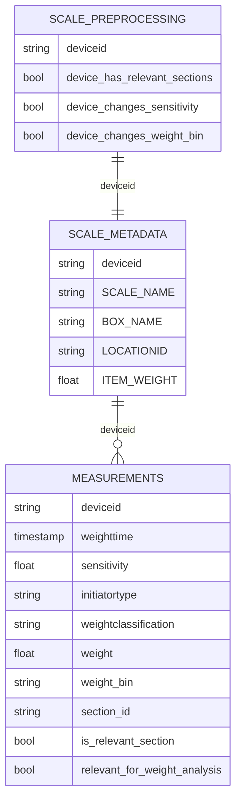

# Data dictionary

Hierarchy: **customer (93) → location/site (180) → scale (18,455) → section → weighing (~7.5M)**.
Every location belongs to exactly one customer. A location holds a median of about 50 scales and a maximum of about 1000.
There is no rack or shelf position anywhere in the data.

## measurements.csv: one row per weighing (event table)

| Column | Meaning | Observed (10 MB sample) | Use |
|---|---|---|---|
| deviceid | scale ID, join key | 13.8k scales in sample | key |
| weighttime | time of weighing (ms) | 2022-03-01 → 2022-06-20 | rates, weight deltas, crosstalk timing, before/after |
| sensitivity | trigger setting 1–10, **higher = more sensitive** | 8 = 65% of rows; **March = 100% level 8**; 5% empty | the control knob |
| minwaittime | min. minutes between two weighings | 1.0 for 85%; 60/30/10 rare; 14% empty (mostly device-level) | filtered to standard, then out of scope |
| delay | seconds from vibration to weighing | 30.0 for 94% | filtered to standard; aligns crosstalk timing |
| weight | measured weight in **integer grams** (1 g resolution) | median 2.9 kg | only differences are used |
| initiatortype | AUTOMATIC = vibration sensor; MANUAL = person or 24 h without activity | 93% / 7% | defines which label is possible |
| weightclassification | OK / TOO_MANY / TOO_FEW | 71% TOO_MANY in sample | **outcome** |
| weight_bin | fill level, 5 quantile bins: `0 - 803`, `803 - 1877`, `1877 - 3859`, `3859 - 6673`, `6673 - 100000` g | ~20% each | weight-in-box parameter (sort it manually: string order ≠ numeric order) |
| section_id | block of consecutive weighings with constant sensitivity **and** weight bin | median 2 rows/section in sample | defines the analysis unit |
| is_relevant_section | section has ≥ 20 weighings over ≥ 5 days | 90% True | filter |
| relevant_for_weight_analysis | **section-level** flag: the scale moved weight bin at constant sensitivity *and "something changed"* | 12% of rows | weight analysis filter (outcome-selected → robustness check added) |

Label logic (verified, 0 violations):

| | weight changed | weight did not change |
|---|---|---|
| **AUTOMATIC** (sensor fired) | OK = correct detection | **TOO_MANY** = false alarm |
| **MANUAL** (person / 24 h check) | **TOO_FEW** = the sensor slept through a change | OK = nothing was missed |

## scale_metadata.csv: one row per scale

| Column | Meaning | Use |
|---|---|---|
| SCALE_NAME | `Cloud-V1.00-6kg` (10.2k) / `Cloud-V1.00-20kg` (7.3k) | `scale_type`, separate analyses |
| BOX_NAME | 8 box types. **Nested in scale type**: SK 2311 & LF 221 only on 6 kg; SK 3521, LF 321 & others only on 20 kg | compared within scale type only |
| LOCATIONID | site ID, arrives as float text (`1234567.0`) | converted to string + anonymous label L001… |
| CUSTOMER_NUMBER | customer | dropped (redundant with location) |
| ITEM_WEIGHT | weight of one part (g), median 4.7 | parameter + pick-size proxy |
| DESCRIPTION | free text in DE/FR/PL/CN; 619 "Reserve" | dropped, except a `is_reserve` flag |
| DIMENSION | e.g. `M 3 x 5` (thread × length), 23% empty | dropped (item weight carries size) |
| SUPPLIER_ITEM_NUMBER | product code (10k levels) | dropped |

985 scales (5.3%) have no metadata at all and are excluded from the scale-type analyses.

## scale_preprocessing.csv: D ONE helper flags, one row per scale

| Column | Meaning | Verified by |
|---|---|---|
| device_has_relevant_sections | the scale has at least one relevant section | recomputed from measurements |
| device_changes_sensitivity | relevant sections at ≥ 2 sensitivity levels, so the same scale can be compared before/after | recomputed |
| device_changes_weight_bin | relevant sections in ≥ 2 weight bins | recomputed |
