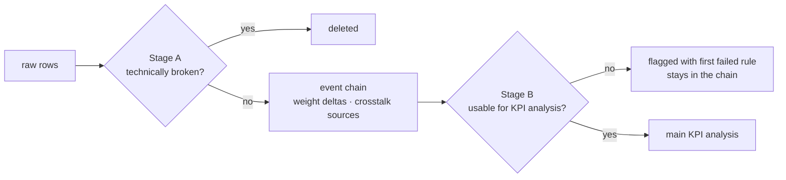

# Data cleaning

Two kinds of rules, because "delete" and "do not use for the KPI" are different decisions.

Why flag instead of delete? A weighing with unknown sensitivity is useless for asking what sensitivity does. It is still a real weighing, though:
- the **weight change of the next row** is computed against it;
- it may be a **real pick that shook a neighbour**.

Deleting it would silently corrupt both analyses.

| Step | Rule | Tier | Action | Rationale |
|---|---|---|---|---|
| A1 | device / time / weight / trigger missing | Mandatory | delete | not a measurement |
| A2 | duplicate (device, timestamp) | Mandatory | delete (keep one) | logging duplicate |
| A3 | trigger type not AUTOMATIC/MANUAL | Mandatory | delete | undefined |
| A4 | before 2022-03-01 | Mandatory | delete | D ONE: sub-optimal settings before March |
| A5 | weight < 0 or > 100 kg | Mandatory | delete | scale error |
| B1 | label missing | Mandatory | flag | outcome unknown |
| B2 | TOO_FEW on AUTOMATIC or TOO_MANY on MANUAL | Mandatory | flag | logically impossible |
| B3 | sensitivity missing | Mandatory | flag | treatment unknown |
| B4 | min-wait ≠ 1 or delay ≠ 30 (explicit values) | Analysis | flag | other trigger settings would confound |
| B5 | scale metadata missing | Analysis | flag | cannot be assigned to 6 kg / 20 kg |
| B6 | section not relevant | Analysis | flag | < 20 weighings or < 5 days, so rates would be noise |
| B7 | sensitivity 3 | Separate | separate study | anomaly (see methodology) |
| B8 | level used by < 30 scales of that type | Analysis | flag | no stable estimate (0, 10) |

Every run writes the funnel (rows and scales removed per rule) to `reports/tables/cleaning_funnel.csv` and to the overview page.

Trust-but-verify checks (`reports/tables/data_checks.csv`):
- each section = one scale, one level, one weight bin;
- `is_relevant_section` recomputed;
- label logic;
- the three preprocessing flags recomputed;
- March = level 8 for ≥ 95% of rows (precondition of the natural experiment);
- share of scales without metadata.
