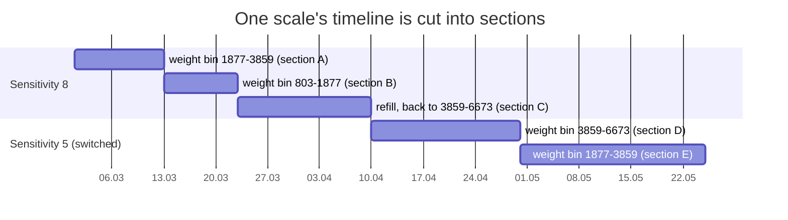

# Methodology

## Units of analysis

| Unit | Definition | Used for |
|---|---|---|
| section | one scale, constant sensitivity and weight bin, consecutive in time | weight-in-box effect; Shapley model |
| device-setting | one scale at one sensitivity, its relevant sections pooled | all KPI comparisons; every scale counts once |
| device-week | one scale, one week, one sensitivity | event study; stayer trend |

A single weighing has no rate. "TOO_FEW per week" only exists over a period. Raw rows are also not independent: chatty scales would dominate any row-level statistic.

## M2: what the knob does (causal)

- March 2022: every scale runs on 8. From April, about 46% of scales are moved to another level ("switchers"); the rest stay on 8 ("stayers").
- **Difference-in-differences.** For each switcher, compute (KPI after − KPI before), minus the change the stayers of the same scale type showed over the same calendar weeks. Everything constant per scale cancels: site, rack, box, item, operators. The stayer trend removes seasonality.
- **Rates.** A conditional (fixed-effects) Poisson rate ratio. Given a scale's total count, the split between before and after is binomial, so each scale's own baseline drops out and zero counts are handled correctly.
- **Sensitivity 3.** Two diagnostics:
  1. *Selection*: were these scales already worse while on 8? (Mann-Whitney)
  2. *Setting quirk*: did moving to 3 increase empty weighings while the neighbouring levels 2 and 4 decrease them?

## M3: parameter influence

- **Shapley R² (LMG).** For p parameters, all 2^p sub-models are fitted; each parameter gets its average marginal contribution to R². The contributions add up exactly to the full-model R² and split shared variance fairly between correlated parameters.
- **Location chance correction.** Location has 180 levels, so it "explains" something even when the labels are random. The noise floor is the R² of shuffled location labels (shuffled across scales, not rows). The verdict uses R² minus that floor.
- **Box type** is nested in scale type and is therefore only judged within a scale type.
- **Thresholds.** < 1% = marginal; 1–6% small; 6–14% medium; > 14% large.

## M4: location

On the baseline level only (so the setting cannot explain differences between sites):
- **ICC(1)**: the share of variance between sites.
- **Permutation test**: the F statistic vs 999 shuffles of site labels across scales.
- **Split-half**: split every site's scales randomly in two and correlate the site rankings (Spearman, 200 repetitions, Spearman–Brown reliability).

## M5: pick size

- **Change events**: AUTOMATIC+OK (detected) or MANUAL+TOO_FEW (missed) with a weight drop against the previous weighing (gap ≤ 7 days).
- **Detection curve**: P(detected | pick grams, level, scale). The logistic fit on log grams gives **D90**, the pick size detected 90% of the time.
- **Label audit**: share of automatic weighings with |Δ| ≤ 2 g, per label.

## M6: crosstalk

- **Sources**: real picks (AUTOMATIC+OK) at *other* scales of the same site. **Targets**: automatic weighings.
- **Cross-correlogram** over ±120 s in 2 s bins. Both scales use the same 30 s delay, so a crosstalk peak sits at lag 0. The width of the "near" window is detected from the peak.
- **Chance level**: the probability of at least one source in a band of equal width starting 60 s away.

  attributable = (P(near) − P(chance)) / (1 − P(chance))

- **Root causes of TOO_MANY**: neighbour-induced (chance-corrected); own echo (own detected pick ≤ 5 min earlier); other.
- **Virtual racks**: pairs co-triggering far above chance (≥ 5 near events, lift ≥ 3) form a weighted graph per site → Louvain communities.

## M7: policy simulator

1. Each scale's own level-8 rates per week (TOO_MANY, detected picks, TOO_FEW, manual OK) are shrunk with 1 pseudo-week toward the scale-type median.
2. These rates are multiplied by the causal rate ratios from M2. This gives the expected KPIs of that scale at every level.
3. Policies compared on the same scales:

| Policy | Rule |
|---|---|
| P0 | status quo: everyone on 8 |
| P1 | one level per scale type |
| P2 | segment table: scale type × pick-size class |
| P3 | adaptive rule, simulated with Poisson noise. Every 14 days: TOO_FEW/week > 2 → +1; TOO_MANY > 0.5 and TOO_FEW ≤ 1 → −1 |
| P4 | oracle (upper bound) |

4. **Backtest.** For switchers, KPIs predicted from their level-8 history are compared with what was actually observed after the switch (MAE, bias, correlation).
5. **Battery.** life_new / life_old = (86400 + 3000·t·n_old) / (86400 + 3000·t·n_new), with t = 2 s as a configurable assumption.

## M0: validation on synthetic ground truth

`smartbin.simulate` builds a fleet with known physics:
- vibration ~ log(pick grams);
- threshold ~ sensitivity;
- crosstalk within hidden racks;
- site-level ambient vibration;
- **no** box effect;
- sensitivity-3 selection plus a firmware quirk.

The pipeline must recover all of it before it is trusted on real data.
