```{=typst}
#show table: set text(size: 8.5pt)
#show table: set par(justify: false)
#show figure.caption: set text(size: 9pt)
```



# Management summary

**Problem.** Every SmartBin Cloud scale weighs its bin when a vibration sensor wakes it up. A weighing draws about 3,000 times the sleep power and loads the radio network, the IoT cloud and ARIMS. A change the sensor sleeps through leaves a wrong stock level until a later weighing finds it. At the factory default (sensitivity 8) the typical 20 kg scale wakes up empty 13.5 times a week and catches 1.5 real picks; the median TOO_MANY fraction is **0.92** (6 kg scales: 8.5 empty wake-ups, 3.0 picks, fraction **0.74**). Only **6%** of the 20 kg and **19%** of the 6 kg scales meet both Bossard targets.

**Approach.** 7.6 million weighings of 18,455 scales (March–June 2022) were cleaned with an explicit rule book and turned into one record per scale and sensitivity level; 6 kg and 20 kg scales are analysed separately. The effect of the setting was measured on the 7,846 scales that Bossard moved away from level 8 in April, each compared with itself and with scales that stayed on 8 (difference-in-differences). Empty wake-ups were timed against picks at the same site, detection was measured per pick size, a trigger-loop detector was run on every scale, nine policies were simulated and three further levers tested.

**Key findings.**

- **The problem is one-sided.** At level 8, 99% (20 kg) and 98% (6 kg) of the scales meet the TOO_FEW target, but only 6% and 20% the TOO_MANY target.
- **More than half of the empty wake-ups of normally working scales coincide with picking at the same site:** beyond chance, **55%** (20 kg) and **56%** (6 kg) come within ±14 seconds of a real pick at another scale of the site once the scales caught in a trigger loop are left out (48% and 42% with them). Picks at a different site of similar size give 0.7%, and the empty wake-ups follow the working day like real picks (r = 0.99). The rest cannot be attributed to picking nearby.
- **The TOO_MANY fraction is the wrong compass.** From level 8 to 1 the same scales lose 97–98% of their empty wake-ups, but the fraction falls only by 0.20–0.23, because real picks are lost as well; TOO_FEW per week stays low even when half of the changes are missed.
- **Rarely used bins look worse.** The least-used fifth of the 20 kg bins has a fraction of 1.00, the most-used fifth 0.63; lower usage explains roughly 60% of the gap between 20 kg and 6 kg scales.
- **Every scale has a blind zone** below about **23 g (20 kg)** or **5 g (6 kg)**; 53% of the 6 kg scales have a typical pick below 25 g.
- **6 kg and 20 kg scales behave like two different instruments:** the step 8 → 6 removes 56% vs. 79% of the empty wake-ups for 3 vs. 6 points more missed changes.
- **A defect, not a setting:** 274 scales (1.5%) were caught in a trigger loop and caused **27% of all automatic weighings** – 219 during a four-week trial of level 3 in April 2022, and 59 on other levels (10% of all automatic weighings).
- **Site and usage show the largest differences;** box type and item weight hardly matter on 20 kg scales.

**Answer to the case question: how to set the sensitivity.** The right setting is not in the master data – it depends on how busy a bin is, its neighbours, its pick size and its site, which only show once the scale runs (a table by pick size chose one level for 95–99% of the scales). But every scale reports its empty wake-ups and missed changes every week, so each scale can learn its level:

| Part | Measure | Scope | Effect |
|---------------|------------------------------------------------------------|------------------|-----------------------------|
| **Flag** | Daily loop detector; looping scales go to service; level 3 stays off the menu until the firmware is fixed | 274 scales in the data, 59 of them outside level 3 | loops caused 27% of all automatic weighings (10% outside level 3); no trade-off with misses |
| **Tune** | Start every scale on level 7; every two weeks one step less sensitive if > 7 empty wake-ups a week and ≤ 5% missed, one step more sensitive if > 10% missed or > 2 TOO_FEW a week; 6 kg and 20 kg monitored apart | all scales without a loop | weighings −61% (20 kg) / −55% (6 kg); median missed changes 11% / 12% (simulated status quo 3% / 5%) |
| **Watch** | KPI 2.0 per scale; keep the 24 h idle check; watch list (12 h check or a higher level) for the 10% of scales that produce 55% / 36% of all TOO_FEW | reporting, few scales | misses found within one to two days; no nightly check for every scale, which would cost 33–40% of the savings |

At the customer sites, parts picked below about 25 g belong on 6 kg scales, and a damping test at the ten sites with the most coupled wake-ups targets the coupled half. Scaled to the 110,000 installed scales, the rule would save roughly **2.1 million weighings per week** – an illustration, not a forecast. The typical scale then misses 11–12% of its changes, just above the 10% limit of KPI 2.0, and no policy reaches Bossard's TOO_MANY target of 0.5 (best median 0.67 / 0.59). Steering by the fraction, one level for all, quiet hours and a longer wait time were tested and rejected (Section 6.5).

# Situation, goal and data

Bossard's SmartBin Cloud places a weighing scale under each bin; the stock level flows into ARIMS, which triggers replenishment automatically. About 110,000 scales were installed by March 2025. The scales run on batteries that should last at least five years. A vibration sensor wakes a scale up when someone touches the bin; the **sensitivity setting (1–10)** decides at which vibration intensity this happens. Two further settings (minimum wait time, measurement delay) are out of scope.

Bossard measures two KPIs per scale: the **TOO_MANY fraction** (empty automatic weighings / all automatic weighings, target ≤ 0.5, alarm > 0.8) and **TOO_FEW per week** (changes the sensor missed, target ≤ 2). **Goal:** answer the three case questions – which parameters have no or only marginal influence, which do influence the result, and how the sensitivity should be set.

**Dataset.** Three files were provided: `measurements.csv` with 7,596,224 weighings of 18,455 scales from 1 March to 20 June 2022, `scale_metadata.csv` (scale type, box, site, item weight) and `scale_preprocessing.csv` (D ONE flags). Each weighing is labelled by who triggered it and whether the weight changed (counts after removing 5,738 duplicate or broken rows; 9,886 rows carry no label):

| Triggered by | Weight changed? | Label | Meaning | Weighings |
|------------------------------|--------------|------------|------------------------|----------:|
| vibration sensor (automatic) | yes | OK | real pick caught | 1,667,762 |
| vibration sensor (automatic) | no | TOO_MANY | empty wake-up | 5,411,757 |
| person or 24 h idle check (manual) | no | OK | nothing missed | 390,225 |
| person or 24 h idle check (manual) | yes | TOO_FEW | change the sensor missed | 110,856 |

76% of all automatic weighings are empty wake-ups. Until the end of March almost every scale ran on the factory default of 8; from April onwards, a large part of the fleet was moved to other levels (@fig-design). This switch is the natural experiment behind the causal estimates in Section 5. It was not randomised, so each switched scale is compared with itself before the switch and with scales that stayed on level 8.

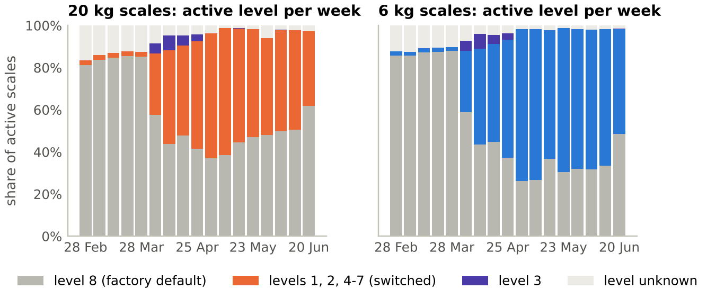{#fig-design width=100%}

# Data preparation

**A rule book in two stages.** Stage A *deletes* rows that cannot be used anywhere: 5,733 duplicate copies (same scale, same millisecond) and 5 physically impossible weights (144 kg to 50 t – exactly the rows D ONE marked as "invalid weight"). Stage B *flags* rows that are unsuitable for the KPI analysis but keeps them, because they are still real weighings: they are needed to compute the weight change of the next weighing and as neighbouring picks in the timing analysis (@fig-cleaning). In total, 5.26 million rows (69%) enter the KPI analysis; every excluded row is exported with its reason.

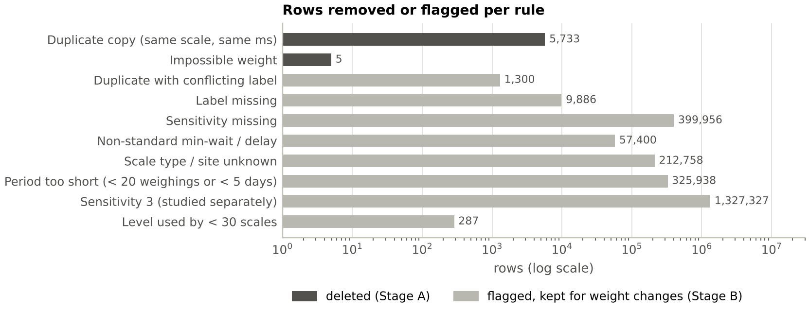{#fig-cleaning width=100%}

Four checks shaped the rules:

- **Duplicates are not all identical.** In 4,199 of 5,499 duplicate groups all copies carry the same label. In the other 1,300 they carry *different* labels (OK and TOO_FEW, or OK and TOO_MANY); one copy is kept for the weight chain, but its outcome is treated as unknown.
- **D ONE's "relevant section" flag is correct.** The rule *at least 20 weighings over at least 5 days* was re-checked on all of about 58,700 sections and holds for 100% of them. Excluded periods have a median of 9 weighings over 4.8 days – too short for a weekly KPI.
- **Missing configuration values behave like the standard.** Rows with an empty minimum wait time show a similar TOO_MANY fraction at level 8 as standard rows (0.79 vs. 0.83 for 20 kg, 0.69 vs. 0.69 for 6 kg) and are kept; only the 0.8% of rows with an explicitly different setting are excluded.
- **Scale type and site are missing for 985 scales**, which therefore cannot be assigned to the 6 kg or 20 kg analysis.

**Unit of analysis: one scale on one sensitivity level.** KPIs are computed per scale and then summarised with the median ("typical scale"), so that every scale counts once. Pooling all weighings would let the noisiest scales dominate: scales on level 3 are 3% of the scale records but produce 19% (20 kg) and 23% (6 kg) of all automatic weighings.

**How missed changes are found.** TOO_FEW can only come from a manual weighing. About 85% of the manual weighings come at least 24 hours after the previous weighing, and 73% of these fall into two two-hour windows of the day (@fig-check). This points to a scheduled job that weighs every scale that has been idle for 24 hours; these checks find 91% of all TOO_FEW. The gap to the previous weighing is 26 to 49 hours (5th to 95th percentile). Two consequences follow. First, a scale cannot produce more than about one TOO_FEW per day, and a missed pick that is followed by an automatic weighing is labelled OK – **TOO_FEW is a lower bound of the misses**. Second, a missed change stays invisible for up to two days if nobody touches the bin.

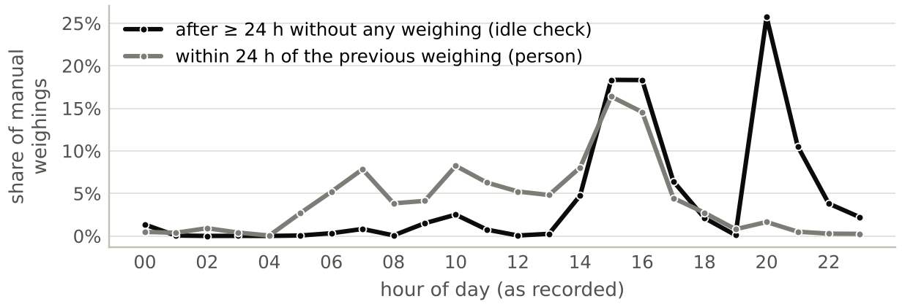{#fig-check width=100%}

# Data analysis

## Today: a one-sided problem

At level 8, the TOO_MANY fraction of most scales is far above the target, while almost every scale meets the TOO_FEW target (@fig-onesided). On 20 kg scales the median fraction is 0.92 and 71% of the scales are above Bossard's alarm level of 0.8; on 6 kg scales the median is 0.74. The typical scale reports only 0.12 (20 kg) or 0.36 (6 kg) missed changes per week. The question is therefore not how to balance two equally violated targets, but **how far the sensitivity can be lowered before real changes are missed**.

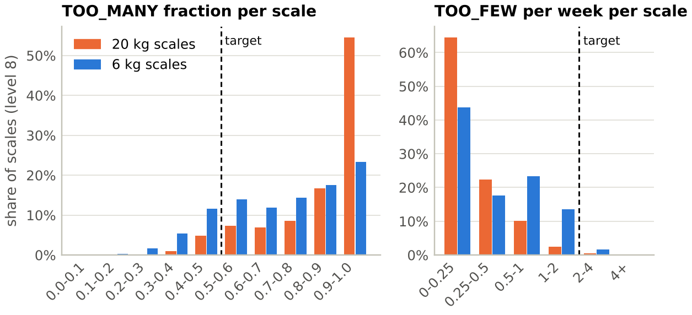{#fig-onesided width=100%}

## How consistent is each sensitivity level?

@fig-classes groups the scales of each level into four classes of the TOO_MANY fraction. Lower levels move scales from the dark red class into the blue classes, but no level reaches a majority within the target: at the best level (1), 31% of the 20 kg and 45% of the 6 kg scales are at or below 0.5 – and 11% and 17% of the scales on level 1 never woke up at all (grey). The spread within every level is wide: the setting explains less than where and how a bin is used. *Note:* this view compares different scales and periods; the causal effect of the setting follows in Section 5.

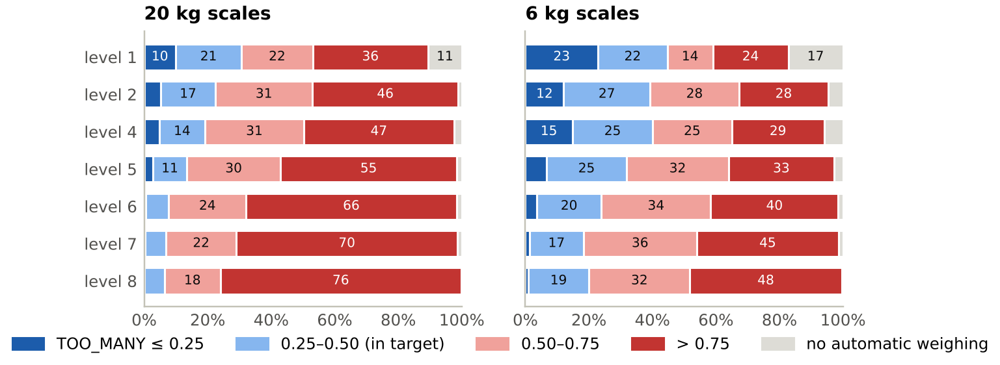{#fig-classes width=100%}

## The fraction is the wrong compass

The TOO_MANY fraction divides two numbers that both depend on the setting. @fig-counts shows them separately for the typical scale on each level. From level 8 to level 1, empty wake-ups fall from 13.5 to 0.55 per week on 20 kg scales (−96%) and from 8.5 to 0.17 on 6 kg scales (−98%). Real picks caught fall almost as fast (1.5 → 0.26 and 3.0 → 0.14 per week), because a less sensitive sensor also sleeps through real picks. The fraction therefore moves far less (0.92 → 0.70 and 0.74 → 0.50). This view compares different scales, but the same pattern holds for the same scales before and after their switch (Section 5): from level 8 to level 1, empty wake-ups fall by 97% and 98%, caught picks by 90% and 96%, and the fraction only by 0.23 and 0.20. A scale on level 1 has a "good" fraction mainly because its sensor is practically switched off.

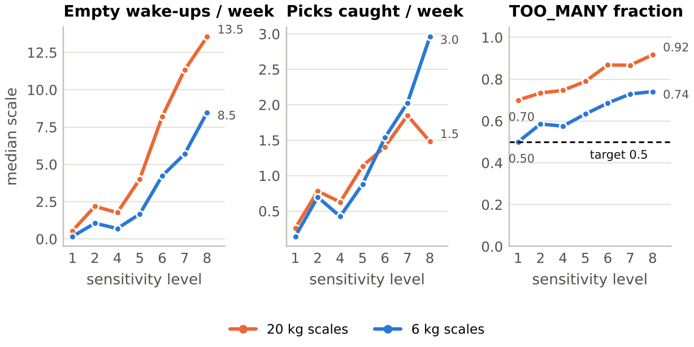{#fig-counts width=100%}

## Rarely used bins look worse – and 20 kg bins are used less

At the same setting, the fraction is strongly related to how often a bin is used (@fig-usage, left). The least-used fifth of the 20 kg bins has a median fraction of 1.00, the most-used fifth 0.63 (Spearman correlation between real picks per week and fraction: −0.82; 6 kg: −0.67). A rarely used bin has few real weighings in the denominator, so every empty wake-up weighs more. Usage also explains a large part of the difference between the scale types (@fig-usage, right). The typical 20 kg bin is picked only 1.5 times a week (6 kg: 3.0) and wakes up empty 13.5 times (6 kg: 8.5). With the lower usage of a 20 kg bin alone, a typical 6 kg bin would have a fraction of about 0.85 instead of 0.74 – roughly 60% of the gap between the scale types. The fraction therefore **penalises slow-moving parts**.

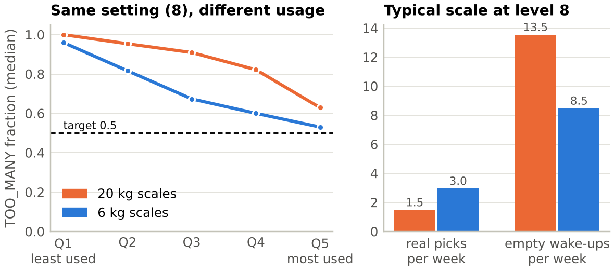{#fig-usage width=100%}

## Empty wake-ups coincide with picking at the same site

**Thesis.** An empty wake-up is caused by activity at the rack: a worker who picks parts from one bin shakes the rack or touches the neighbouring bins, and their sensors wake up although nothing was taken from them.

**Test.** For every empty wake-up, we looked for real picks (automatic OK weighings) at *other* scales of the same site within a time window around it. The data contain no rack positions, so the whole site is the neighbourhood. If wake-ups and picks were unrelated, picks would be spread evenly over time. Instead, they pile up sharply at the moment of the empty wake-up (@fig-coupling, left and centre): the rate of picks at other scales jumps from about 1 per minute (chance level) to about 9 per minute. The peak is about ±14 seconds wide; both sensors use the same 30-second measurement delay, so the peak sits at zero.

**Result.** At level 8, 60% of the empty wake-ups of 20 kg scales have a pick at another scale of the site within ±14 s. In an equally wide control window 60–88 s later, the same holds for only 22% – that is the chance level of a busy site (@fig-coupling, right). The share that is explained beyond chance is

$$a = \frac{p_\text{near} - p_\text{chance}}{1 - p_\text{chance}} = \frac{0.596 - 0.221}{1 - 0.221} = 0.48$$

for 20 kg scales and 0.42 for 6 kg scales (0.45 across both types): **almost half of all empty wake-ups are linked to picking at the same site at the same moment**. A scale's own "echo" (a wake-up within 5 minutes after its own pick) explains only 1–3%.

**Without the looping scales, and three further tests.** The 274 scales caught in a trigger loop (Section 5.3) wake up around the clock, also when nobody picks, and dilute the link. Without them the share rises to **0.55 (20 kg) and 0.56 (6 kg)**: more than half of the empty wake-ups of normally working scales coincide with picking at the same site. Three tests show that this is not an artefact of busy hours (Appendix C): (1) a *placebo* – picks at a different site of similar size at the same moment – gives 0.7% beyond chance; (2) the share rises with the activity of the site, from 38–39% in hours with 1–5 picks at the site to 69–72% in hours with more than 50; (3) it is not driven by a few scales: 99.8–99.9% of the scales have more picks nearby than in the chance window (median per scale 63% and 67%). The rest – 45% (20 kg) and 44% (6 kg), including a scale's own echo – cannot be attributed to picking at the same site and remain unexplained.

**When.** Empty wake-ups also follow the working day like real picks: the hourly profiles of empty wake-ups and caught picks correlate at r = 0.998 (20 kg) and 0.988 (6 kg), and only 2.4% and 2.5% of the empty wake-ups happen at weekends (scales caught in a trigger loop left out). A night or weekend mode would therefore not help (tested in Section 6.5).

**What it does and does not show.** The same peak appears around *real* picks (grey lines; 54% and 53% beyond chance): people pick several bins in a row. The data therefore show that empty wake-ups are **coupled to activity at the site**, but they cannot separate vibration travelling through the rack from a worker touching the bin, or from a real pick too small to count (next section); machines working in shifts would also follow the working day. A short on-site test with an accelerometer or a damping pad would settle this. The coupling also does not explain why some sites are worse than others (it accounts for only 7% and 14% of the differences between sites).

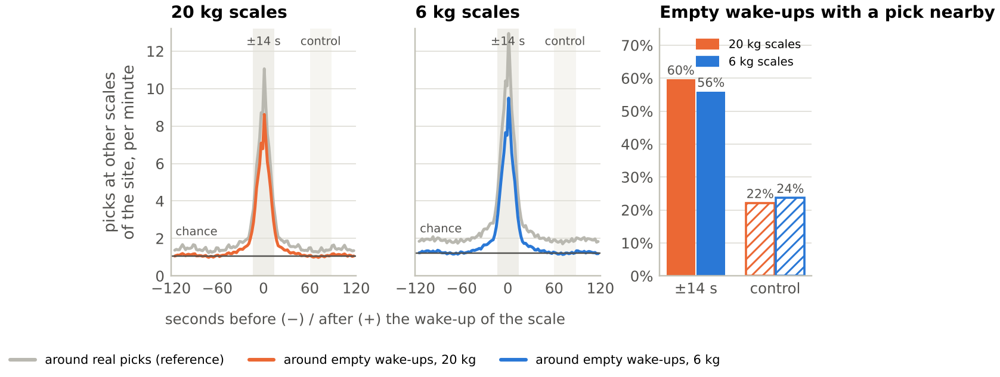{#fig-coupling width=100%}

## The scale's blind zone and the efficient range

The cloud labels a weighing as "changed" only if the weight changed by more than a significance threshold. The threshold is not documented; it was estimated from the data as the lower end of the changes reported as missed (5th percentile of TOO_FEW pick sizes): **about 23 g on 20 kg scales and 5 g on 6 kg scales**. It is not a sharp line: about 2% (20 kg) and 5% (6 kg) of the caught picks are smaller. @fig-blind shows the weight change behind each label. Most empty wake-ups really are empty (76% of them show at most 2 g on 20 kg scales, 88% on 6 kg scales). But 24% (20 kg) and 12% (6 kg) show a change of more than 2 g that the scale still classed as "no change" – part of these are probably single small parts that the scale does not count. Below the threshold a pick is largely invisible: it is labelled TOO_MANY when the sensor wakes up and never reported when it does not.

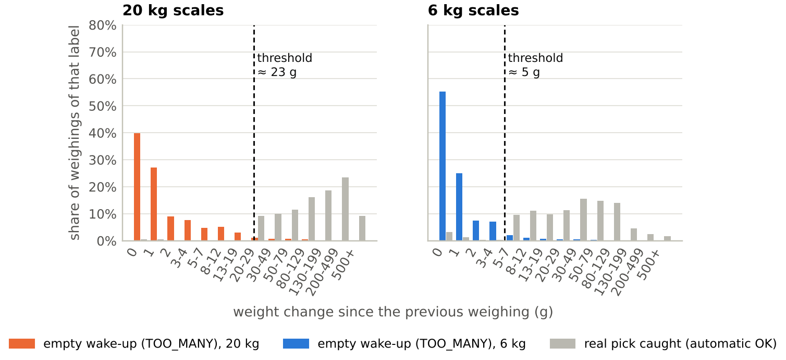{#fig-blind width=100%}

Above the threshold, detection depends on the pick size and the level (@fig-zones). A pick counts as detected when the sensor wakes up for it (automatic OK) and as missed when only a later manual weighing finds the change (TOO_FEW).

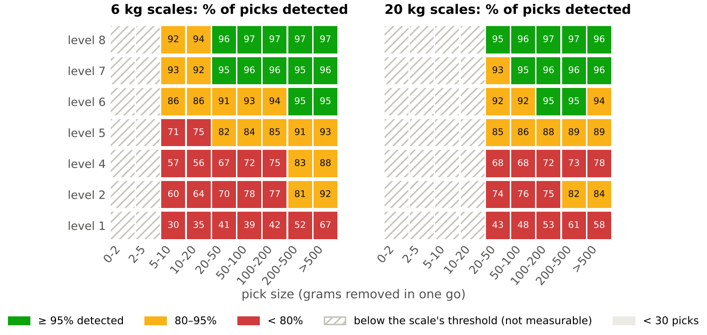{#fig-zones width=100%}

This gives a simple rule for each scale type – **the efficient range** (lowest level that still detects at least 95% of the picks of a given size):

| Typical pick size | 6 kg scale | 20 kg scale |
|--------------------------|-------------------------------------------|-------------------------------------|
| below 5 g | below the threshold | below the threshold |
| 5–20 g | no level reaches 95% (levels 7–8: 92.4–94.8%) | below the threshold (≈ 23 g) |
| 20–50 g | level 7 | level 8 |
| 50–100 g | level 7 | level 7 |
| 100–200 g | level 7 | level 6 |
| 200–500 g | level 6 | level 6 |
| above 500 g | level 6 | level 7 |

Levels 1–5 do not reach 95% for any pick size: they detect only 30–93% of the picks on 6 kg and 43–89% on 20 kg scales. Two consequences follow: small parts with picks below about 25 g belong on 6 kg scales, and no level below 6 is acceptable for any pick size.

## Sites differ strongly and reproducibly

The site shows the largest differences (@fig-location). Among 20 kg scales on level 8, the median TOO_MANY fraction of the sites ranges from 0.61 to 0.97 (10th to 90th percentile; 6 kg: 0.48–0.92). The differences are not chance: 42% (20 kg) and 40% (6 kg) of the variation between scales lies between sites (intraclass correlation), a permutation test with 999 shuffles gives p ≤ 0.001, and two random halves of each site agree closely (split-half r = 0.76 and 0.85). The effect remains after removing differences in usage (ICC 0.44 and 0.40). Possible reasons are rack construction, shelf positions, nearby machines and the way people work; the data contain only the site, not the rack.

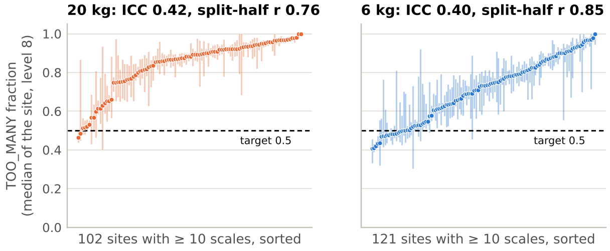{#fig-location width=100%}

## Which parameters matter

@fig-params compares the parameters by a simple measure: how far apart are the best and the worst group? To avoid mixing in the setting, all parameters except the sensitivity are compared on level 8 only. For sites, the 10th and 90th percentile of the site medians are used, so that a few small sites do not dominate.

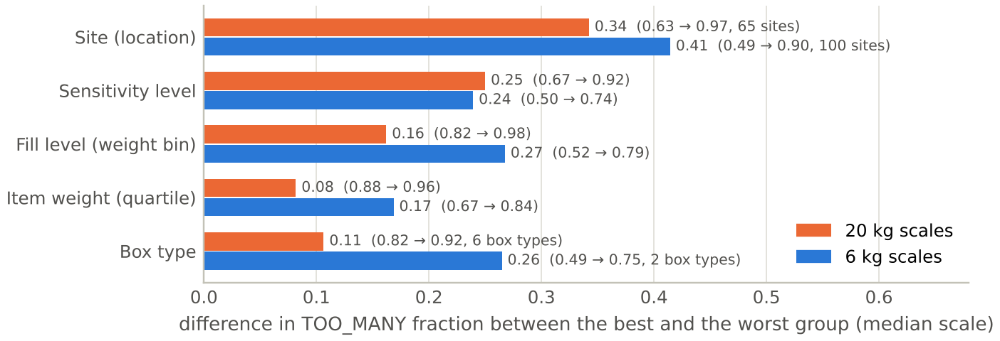{#fig-params width=100%}

On 20 kg scales the site moves the fraction most (0.34), followed by the sensitivity level (0.25) and the fill level of the box (0.16); box type (0.11) and item weight (0.08) come last. On 6 kg scales the site also leads (0.41), followed by the fill level (0.27), the box type (0.26, only two common types) and the sensitivity (0.24). The fill-level effect is much smaller when the *same* scale changes its fill level: −0.045 (20 kg) and −0.027 (6 kg) when the box gets heavier. The larger cross-sectional difference probably reflects that nearly empty boxes are also rarely used boxes. D ONE's subset `relevant_for_weight_analysis` shows −0.25 and −0.12, because it was selected on scales where "something changes" – that is, on the outcome. Item weight and box type matter little on 20 kg scales; on 6 kg scales only two box types are common, and they are concentrated on different sites. Usage – the least- vs. the most-used fifth of the bins (Section 4.4) – spreads about as much as the site (0.37 and 0.43).

| Case question | Answer |
|----------------------------------------|----------------------------------------------------------------|
| 1. No or only marginal influence | box type and item weight on 20 kg scales (1–2% of the variance each); fill level within the same scale (−0.03 to −0.05) |
| 2. Influence on the result | site and usage (largest); the sensitivity setting (Section 5); on 6 kg scales also item weight and box type |
| 3. How to set the sensitivity | per scale, learned from its own weekly KPIs with a two-weekly rule, separately for both scale types – after trigger loops are repaired (Section 6) |

A Shapley decomposition of the explained variance (Appendix B) also puts the site first, but gives the sensitivity only 1.5% of the variance (3.4% of the explained part). This does not mean the knob is weak: partly because most of the data come from level 8, where almost every scale ran in March, the observed differences between scales are mostly not differences in the setting. Its real strength is measured in the next section.

# The sensitivity knob

## Same scale, before and after the switch

For each of the 7,846 switched scales, the KPIs after the switch were compared with its own KPIs on level 8. The change in a balanced group of scales that stayed on level 8 over the same weeks was subtracted, which removes calendar effects (difference-in-differences). Counts per week were compared with a fixed-effects Poisson model; intervals are 95% bootstrap intervals over scales.

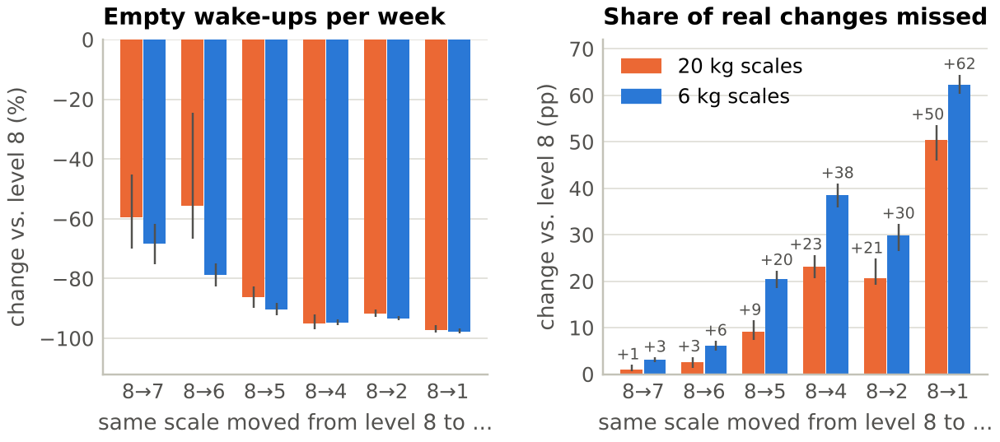{#fig-knob width=100%}

| From level 8 to … | 7 | 6 | 5 | 4 | 2 | 1 |
|------------------------------------|---------:|---------:|--------:|--------:|--------:|--------:|
| 20 kg: empty wake-ups per week | −59% | −56% | −86% | −95% | −92% | −97% |
| 20 kg: missed changes (pp) | +1 | +3 | +9 | +23 | +21 | +50 |
| 20 kg: TOO_MANY fraction | −0.05 | −0.07 | −0.10 | −0.15 | −0.12 | −0.23 |
| 6 kg: empty wake-ups per week | −68% | −79% | −90% | −95% | −93% | −98% |
| 6 kg: missed changes (pp) | +3 | +6 | +20 | +38 | +30 | +62 |
| 6 kg: TOO_MANY fraction | −0.05 | −0.08 | −0.11 | −0.16 | −0.15 | −0.20 |
| Scales (20 kg / 6 kg) | 639 / 1,116 | 639 / 1,134 | 529 / 954 | 453 / 805 | 464 / 906 | 372 / 735 |

The knob is powerful: the first steps (8 → 7 → 6) remove an estimated 56–79% of the empty wake-ups at a cost of 1–6 percentage points of missed changes. The 20 kg estimates are less precise (8 → 6: −24% to −67%, 95% interval). Below level 6, the price in missed changes rises steeply. Levels 2 and 4 are almost equivalent. Without the 274 scales caught in a trigger loop (Section 5.3), 8 → 7 removes 52% (20 kg) and 59% (6 kg) of the empty wake-ups and 8 → 6 removes 67% and 74%, for the same extra misses (Appendix C) – a few looping scales that were switched carried very large counts. One caveat: Bossard seems to have switched some busy scales first – in the weeks before the switch, empty wake-ups per scale and day rose, most for 20 kg scales later moved to level 4–5 (from about 8.5 to 14.8; Appendix B). Part of the drop may therefore be a return to normal, and the first steps are best read as "roughly half to two thirds fewer empty wake-ups".

## Two different instruments

The same nominal level does not mean the same thing on both scale types:

| | 20 kg | 6 kg |
|--------------------------------------------------------|---------------:|---------------:|
| Significance threshold | ≈ 23 g | ≈ 5 g |
| Caught picks per week (typical scale, level 8) | 1.5 | 3.0 |
| Empty wake-ups per week (typical scale, level 8) | 13.5 | 8.5 |
| Level 8 → 6: empty wake-ups | −56% | −79% |
| Level 8 → 6: missed changes | +3 pp | +6 pp |
| Second-largest share of explained variance (Appendix B) | fill level | item weight |

The 6 kg scales react more strongly to the knob in *both* directions. Whether level *n* stands for the same vibration threshold on both hardware versions is not documented. **Recommendation: calibrate, set and monitor the sensitivity separately for each scale type; never apply one number to both.**

## Trigger loops: a defect, not a setting

The case description advises ignoring level 3. The data show why – and that the problem is not only level 3. Level 3 was used during a four-week trial in April 2022 (@fig-design). Together, the 907 scales on that level woke up 146 (20 kg) and 162 (6 kg) times per scale and day on average – 13 times as often as the same scales on level 8 (@fig-sens3). The typical (median) level-3 scale was less extreme, with 17 (20 kg) and 32 (6 kg) weighings a day: a minority of scales caught in a loop produced most of the wake-ups. The median gap between two wake-ups was 90 seconds, which equals the minimum wait time (60 s) plus the measurement delay (30 s); 73–75% of the wake-ups followed the previous one within 2 minutes, and a third came at night. Part of the difference is selection: these scales were already busier on level 8 (5.1 vs. 2.5 weighings per day on 20 kg scales).

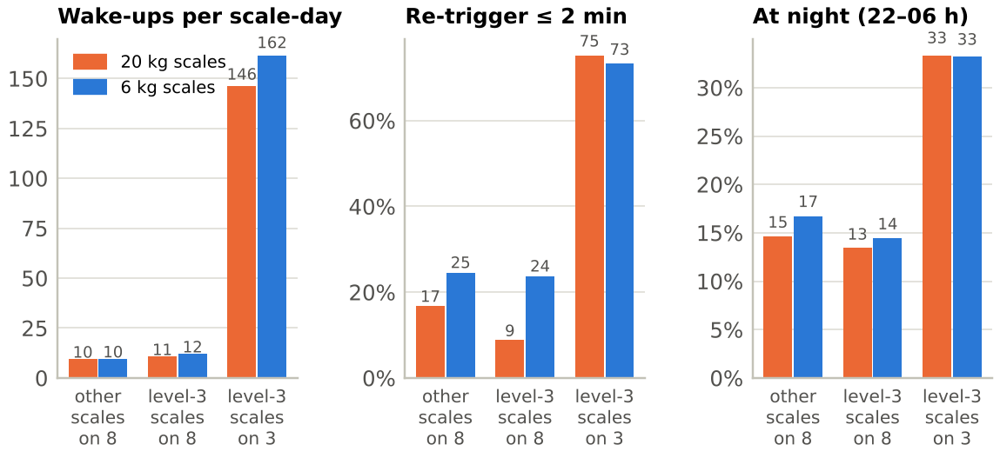{#fig-sens3 width=100%}

**A loop detector for every level.** A scale counts as looping on a level if more than half of its wake-ups follow the previous one within 2 minutes and it wakes up more than 20 times a day, judged over at least 5 days. The rule finds **274 scales (1.5%)**: 219 on level 3 – a quarter of the 833 level-3 scales it could judge – and 59 on other levels, mostly on level 8 (4 scales loop on both). The typical looping level-3 scale woke up 670 times a day, the typical other looping scale 291 times. Together these scales produced **27% of all automatic weighings** in the data (@fig-loops); the loops outside level 3 alone produced 10%. With the case's battery assumption (about 2 s per weighing at about 3,000 times the sleep power), a level-3 loop would empty a battery designed for five years in about six weeks, a loop on another level in about 14 weeks. A different sensitivity is not the fix: this is a defect for service and firmware. The looping scales are left out of the policy savings in Section 6.

**Why these are loops and not busy bins.** The looping scale-levels differ from normal ones in every way that real use would not explain (Appendix C). The median gap between two wake-ups is 90 seconds (normal scales: 18 minutes), and 52% of the gaps fall between 85 and 95 seconds (normal: 3.5%). 21% of their wake-ups come between midnight and 5 am (normal: 7%; real picks: 10%) and 30% at weekends (normal: 3%). Only 1.7% of their empty wake-ups coincide with a pick nearby beyond chance, against 55% for normal scales. 88% of them loop on at least 80% of their observed days. Most telling, the same scales behave normally on their other levels: all 215 level-3 loopers that were also seen on another level, and all 35 such loopers from other levels, were normal there (median 2.8 and 16.6 wake-ups a day). The hardware is therefore not broken. A scale falls into a self-triggering state on a particular setting, which points to the firmware.

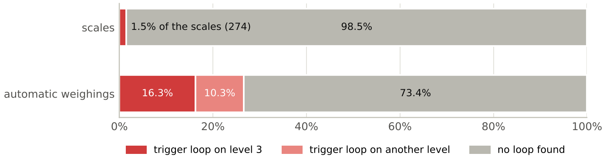{#fig-loops width=100%}

# Recommendation and effect

## KPI 2.0

Bossard's fraction punishes rarely used bins (Section 4.4), and the TOO_FEW target is met by almost every scale even when it misses many changes: on level 1, where half or more of the real changes are missed, 98% (20 kg) and 93% (6 kg) of the scales still meet it. We therefore propose to measure the load and the service level directly:

| KPI 2.0 | Target | Why |
|----------------------------------------------------------|----------|----------------------------------------------------|
| TOO_MANY per week (absolute) | ≤ 7 | battery, radio and cloud pay per weighing, not per ratio |
| Share of real changes missed: TOO_FEW / (caught picks + TOO_FEW) | ≤ 10% | the service the customer actually receives |
| TOO_FEW per week | ≤ 2 | Bossard's own floor, kept |

## Why a rule and not a table

The parameters Bossard knows before installing a bin – box type and item weight – matter little next to site and usage (Section 4.8). What matters – how busy a bin is, what happens on the rack next to it, how small its picks are and how its site behaves – only shows once the scale is running. A lookup table therefore cannot carry the setting: in the simulation, a table by pick-size class chose the same level as one level for all for 95–99% of the scales. But every scale reports the two numbers that decide its setting every week: its empty wake-ups and its missed changes. The recommendation therefore lets each scale learn its level with a simple, auditable feedback rule.

## Policies compared

A simulation applies nine policies to every scale. Each scale keeps its own behaviour on level 8 (its rates of empty wake-ups, picks and misses), and the causal rate ratios of Section 5 translate this behaviour to any other level; every rule is run five times with independent random streams. The policies are: **P0** today (level 8); **P1** the best single level for Bossard's KPIs (20 kg: 4, 6 kg: 2); **P2** a table by pick-size class; **P3** an adaptive rule for Bossard's KPIs; **P4** the best level per scale in hindsight (oracle); **P5** the best single level for KPI 2.0 (20 kg: 7, 6 kg: 6); **P6** an adaptive rule for KPI 2.0 that starts on level 8; **P7** the same rule starting on level 7; and **P8** a daily rule that steers by the TOO_MANY fraction. The KPI 2.0 rule reviews every scale every two weeks. It goes one level *more* sensitive if the scale missed more than 10% of its changes or had more than 2 TOO_FEW per week, and one level *less* sensitive if it woke up empty more than 7 times a week while missing at most 5%.

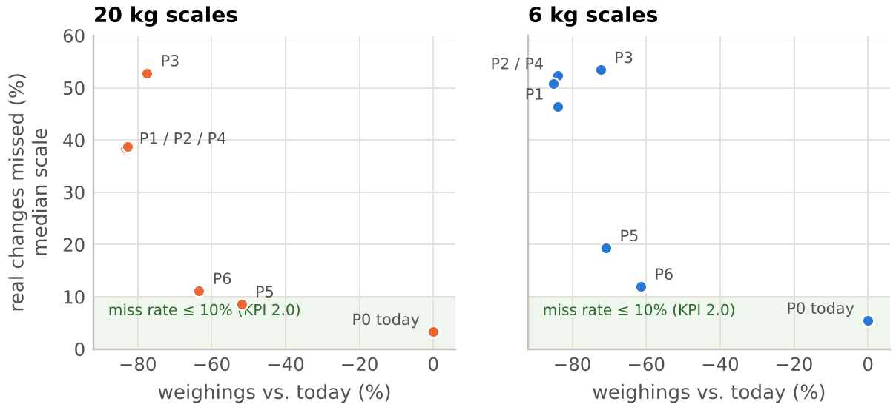{#fig-policies width=100%}

| Policy | Scale | In target (Bossard) | In target (KPI 2.0) | Missed changes (median) | Weighings vs. today | Battery life |
|-----------------------------|--------|-----------:|-----------:|-----------:|-----------:|----------:|
| P0 today (simulated) | 20 kg | 2% | 4% | 3% | 0% | 0% |
| P1 one level for Bossard's KPIs | 20 kg | 19% | 7% | 38% | −82% | +15% |
| P5 one level for KPI 2.0 | 20 kg | 8% | 20% | 9% | −51% | +9% |
| P6 rule for KPI 2.0, start 8 | 20 kg | 7% | 26% | 11% | −60% | +8% |
| **P7 rule for KPI 2.0, start 7** | **20 kg** | 7% | **26%** | **11%** | **−61%** | +8% |
| P8 steer by the fraction | 20 kg | 13% | 3% | 47% | −74% | +14% |
| P0 today (simulated) | 6 kg | 9% | 7% | 5% | 0% | 0% |
| P1 one level for Bossard's KPIs | 6 kg | 26% | 4% | 46% | −82% | +12% |
| P5 one level for KPI 2.0 | 6 kg | 21% | 12% | 19% | −69% | +10% |
| P6 rule for KPI 2.0, start 8 | 6 kg | 12% | 19% | 12% | −55% | +5% |
| **P7 rule for KPI 2.0, start 7** | **6 kg** | 12% | **18%** | **12%** | **−55%** | +5% |
| P8 steer by the fraction | 6 kg | 19% | 2% | 46% | −68% | +10% |

Weighings are counted without the scales caught in a trigger loop. The policies that optimise Bossard's KPIs (P1–P4) reach the highest share "in target" but miss 38–54% of all real changes: they achieve the target by switching the sensor practically off. Steering by the fraction (P8) is the clearest case: it pushes 45% of the 20 kg scales to level 1 and misses 46–47% of the changes – when a measure becomes a target, it ceases to be a good measure (Strathern, 1997). **P7 is the recommended policy.** It saves as much as P6 with one step less, and a scale changes its level about once a month. The typical scale ends at 11–12% missed changes, just above the 10% limit, because the rule keeps testing the next lower level; a stricter step-down threshold would miss less and save less and should be tuned in a pilot. After 16 weeks, 56% of the 20 kg and 79% of the 6 kg scales sit on level 7 or 8 (@fig-levels): many 6 kg scales handle small picks and cannot afford a lower setting.

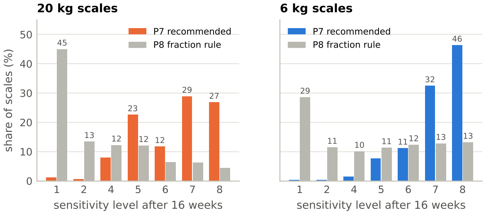{#fig-levels width=100%}

The simulation is stricter than the observed data: in the simulated status quo only 2% (20 kg) and 9% (6 kg) of the scales are in target, against 6% and 19% observed (Section 4.1). The policies should therefore be compared with P0 rather than read as absolute shares. A back-test on the real switchers shows that the simulation is somewhat optimistic (in 11 of 12 groups it predicts a lower TOO_MANY fraction than observed, by up to 0.11) and predicts individual scales only roughly (correlation 0.31–0.68 between predicted and observed fraction). The battery effect (+5% to +8%) is smaller than the drop in weighings, because the assumed sleep consumption dominates the energy budget; the large gains are on the radio network, the cloud and ARIMS, and on the looping scales. If the 110,000 installed scales behaved like the scales in the data, P7 would save roughly 2.1 million weighings per week (about 19 per scale and week) – an illustration, not a forecast.

## Flag, tune, watch

The recommendation combines three parts. **Flag:** the loop detector of Section 5.3 runs every day and sends looping scales to service; level 3 stays off the menu until the firmware is fixed. **Tune:** every scale starts on level 7 and runs the rule P7; 6 kg and 20 kg scales use the same rule but are reported separately. **Watch:** KPI 2.0 is reported per scale, and the existing 24-hour idle check stays as the safety net – it finds 91% of the detected misses (TOO_FEW), one to two days after the last weighing. Misses are concentrated: 41% (20 kg) and 25% (6 kg) of the scales had no TOO_FEW at all on level 8, while the 10% of the scales with the most TOO_FEW produced 55% and 36% of them. These scales go on a watch list with a 12-hour check or a higher level. How long a missed change stays invisible was measured directly as the time since the previous weighing of every TOO_FEW: a median of 33 hours (20 kg) and 38 hours (6 kg); 83% and 76% are found within 48 hours, but 1% take six to seven days – most likely scales that were offline or skipped by the check. A cheap cloud-side alarm for scales without any weighing for 48 hours closes this gap without a single extra weighing. A nightly check for every scale, as proposed in an earlier draft, would cost 7 weighings per scale and week – 33% (20 kg) and 40% (6 kg) of the savings of P7 – and is not recommended.

## Other levers we tested

| Lever | Test | Result (20 kg / 6 kg) | Verdict |
|----------------------------|--------------------------------------|-------------------------------------------|--------------|
| Quiet hours per site | hours of the week with ≤ 1% of a site's picks in March–April (median 109 h), applied to May–June | would avoid 6.4% / 5.5% of the empty wake-ups, while 3.7% / 4.6% of the real picks fall into them | reject |
| Merge bursts | after a weighing, collect wake-ups for 10 minutes and weigh once at the end | −13% / −14% weighings on today's sequences, −5% / −4% on top of level 7; no change missed, 38% of the picks reported about 5 minutes later | optional firmware item |
| Longer minimum wait time | 60-minute vs. standard wait time | 76% / 82% of the 60-minute scales sit at two sites and 40% / 49% on level 1; no scale ran on both wait times at one level – effect not measurable | out of scope |

About 36% of all automatic weighings follow the previous weighing of the same scale within 10 minutes, for real picks and empty wake-ups alike: weighings come in bursts of activity. Merging a burst into one weighing saves weighings without missing a change, but it needs a firmware change and adds little once the sensitivity is lowered.

# General recommendations

1. **Run a daily loop detector** (more than half of the wake-ups within 2 minutes and more than 20 a day) and send looping scales to service; keep level 3 off the setting menu until the firmware is fixed.
2. **Start every scale on level 7 and let it learn its level with the two-weekly rule (P7)**: one step less sensitive while empty wake-ups exceed 7 per week and misses stay at or below 5%, one step more sensitive when misses exceed 10% or TOO_FEW exceeds 2 per week. Run it separately for 6 kg and 20 kg scales and pilot it on a few sites against matched control sites first.
3. **Never use a level below 6 as a fixed setting for all scales.** Below 6, the scales miss 9 to 62 percentage points more of the real changes; level 1 practically switches the sensor off. Only the rule may move individual scales lower while their misses stay low.
4. **Report KPI 2.0** (TOO_MANY per week, share of changes missed) next to Bossard's KPIs, and stop judging slow-moving bins by the fraction.
5. **Keep the 24-hour idle check and add a watch list** (12-hour check or a higher level) for the few scales where misses concentrate, instead of a nightly check for every scale; raise an alarm for any scale without a weighing for 48 hours.
6. **Use the efficient range when placing parts.** Parts picked in amounts below about 25 g belong on 6 kg scales; on 20 kg scales they are largely invisible.
7. **Test the rack hypothesis on site.** Run an accelerometer or damping-pad test at one of the ten sites that hold almost half of the coupled empty wake-ups.
8. **Clarify three facts with Bossard and the firmware team:** the exact rule and schedule of the idle check, the physical meaning of the sensitivity levels on both scale types, and the definition of the significance threshold.
9. **Optional firmware item:** merge bursts of wake-ups into one weighing at the end of a 10-minute window.

# Limitations and outlook

The data are **observational**. The before/after design removes everything that is constant per scale as well as calendar effects, but cannot rule out events that happened only to switched scales around their switch – and some of them were busier than usual just before it (Section 5.1). The figures in Section 4 compare different scales and periods and are descriptive. **TOO_FEW is a lower bound** of the misses (Section 3), so the true miss rates are somewhat higher than reported, probably for every policy, though not necessarily to the same degree. The **site** is the finest location in the data; racks were only inferred from timing. The **coupling analysis** links more than half of the empty wake-ups of normally working scales to picking at the same site but cannot separate vibration through the rack from touching the bin or from picks below the threshold; the **rest remains unexplained**. The **idle-check rule** and the **significance threshold** were inferred from the data and should be confirmed by Bossard. The **battery effect** rests on an assumed consumption model (2 s per weighing at 3,000 times the sleep power). The data cover **one season** (March–June 2022), and the loop figures mostly reflect the April trial of level 3. The **policy simulation** is stricter than the observed status quo, somewhat optimistic in the back-test and predicts individual scales only roughly; its numbers serve to compare policies, not as forecasts. Under the recommended rule the typical scale ends just above the 10% miss limit; the step-down threshold should be tuned in the pilot.

**Outlook:** a pilot of the rule with matched control sites, an on-site vibration test, a firmware fix for level 3 and the loop detector, and KPI 2.0 reporting for every scale. A next analysis step is to model the empty wake-ups per site and rack directly, using the inferred groups of neighbouring scales.



# Appendix {.unnumbered}

## A. Method details {.unnumbered}

- **KPIs per scale and level:** TOO_MANY fraction = TOO_MANY / automatic weighings; TOO_FEW per week = TOO_FEW / observed weeks; missed changes = TOO_FEW / (automatic OK + TOO_FEW). Periods with fewer than 20 weighings or less than 5 days are excluded (D ONE rule). "Typical scale" = median over scales.
- **Cleaning:** Stage A deletes duplicates (same scale and millisecond; the first copy is kept) and weights below 0 or above 100 kg. Stage B flags, in this order: conflicting duplicates, missing label, inconsistent label, missing sensitivity, explicitly non-standard minimum wait time or delay, missing scale metadata, short periods, level 3, and levels used by fewer than 30 scales of a type.
- **Difference-in-differences:** switched scales (level 8 before, one lower level after) against a balanced group of scales observed on level 8 from the first to the last weeks. Counts per week were modelled with a scale fixed-effects Poisson model (rate ratios); 95% intervals from 300 bootstrap samples over scales.
- **Coupling analysis:** sources are automatic OK weighings at other scales of the same site, targets are automatic weighings at level 8. The ±14 s window was taken from the width of the peak; the chance level is the share in an equally wide window 60–88 s after the target. The attributable share is $a = (p_\text{near} - p_\text{chance}) / (1 - p_\text{chance})$.
- **Significance threshold:** 5th percentile of the weight changes of TOO_FEW weighings per scale type.
- **Detection by pick size:** pick size = weight drop since the previous weighing (at most 7 days earlier). Detected = automatic OK, missed = TOO_FEW. Cells need at least 30 picks. A TOO_FEW can bundle several missed picks, which biases the rates in two opposite directions: fewer misses are counted (detection looks better), and they appear as larger picks (detection of large picks looks worse). A missed pick that is followed by an automatic weighing counts as detected.
- **Site effect:** intraclass correlation, permutation F-test (999 shuffles of site labels), split-half reliability (random halves of the scales of each site, 200 repetitions); usage adjustment by deciles of real picks per week.
- **Parameter spread:** median TOO_MANY fraction per group (at least 30 scales; sites at least 20), level 8 only except for the sensitivity; spread = best minus worst group, for sites the 10th–90th percentile of the site medians.
- **Policy simulation:** per scale, its level-8 rates (shrunk towards the scale-type mean with one pseudo-week) multiplied by the causal rate ratios; rules simulated over 8 two-week cycles with 5 replications; weighings and battery life with 2 s per weighing at 3,000 times the sleep power; back-test on the real switchers. Savings are reported without the scales caught in a trigger loop.
- **Trigger loops:** per scale and level with at least 5 days of automatic weighings: share of wake-ups within 120 s of the previous one (> 50%) and automatic weighings per day (> 20).
- **Other levers:** hourly profiles of caught picks and empty wake-ups (scales without a loop); quiet hours learned per site on March–April and tested on May–June; bursts merged on the observed sequences, and on sequences thinned with the rate ratios of level 7; minimum wait time compared across scales and sites.
- **Reproducibility:** `python -m smartbin run` runs the pipeline; `python report/build_figures.py` builds the figures and the aggregated tables in `report/data/`; `quarto render report/report.qmd` builds this report.

## B. Additional figures {.unnumbered}

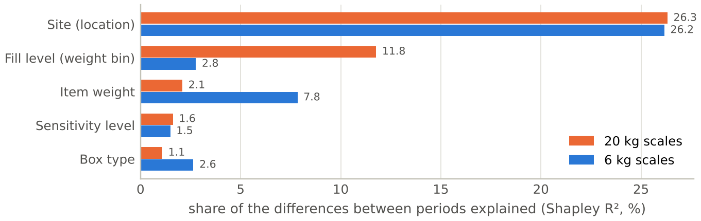{width=100%}

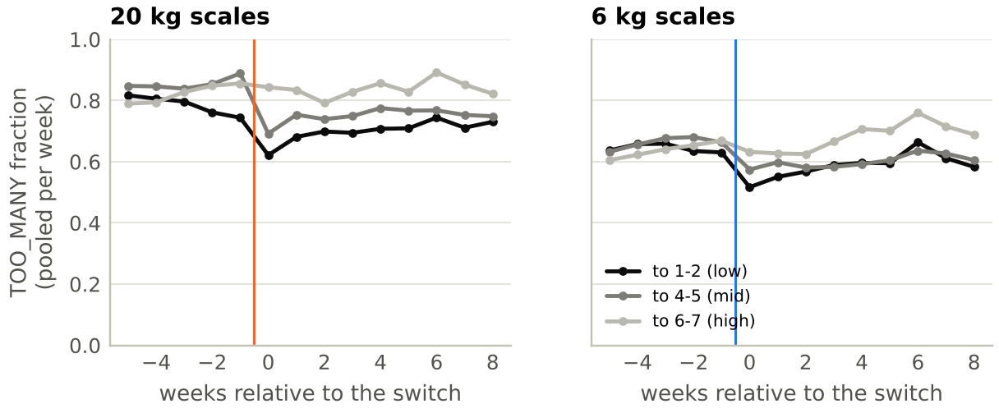{width=100%}

## C. Robustness: the results without the looping scales {.unnumbered}

The 274 scales caught in a trigger loop (Section 5.3) are a defect, not a reaction to the setting. Every key result was therefore recomputed without them (all their levels left out; `report/robustness_loops.py`):

| Result | All scales | Without loop scales |
|---------------------------------------------------------|------------------:|------------------:|
| Typical scale on level 8: empty wake-ups per week (20 kg / 6 kg) | 13.5 / 8.5 | 13.5 / 8.4 |
| Typical TOO_MANY fraction on level 8 | 0.92 / 0.74 | 0.92 / 0.74 |
| Empty wake-ups coupled to picks at the same site, beyond chance (20 kg / 6 kg) | 48% / 42% | 55% / 56% |
| Placebo: picks at another site of similar size | – | 0.5% / 1.0% |
| 8 → 7: empty wake-ups | −59% / −68% | −52% / −59% |
| 8 → 6: empty wake-ups | −56% / −79% | −67% / −74% |
| 8 → 7: extra changes missed (points) | +1 / +3 | +2 / +3 |
| Recommended rule P7: weighings vs. today | −61% / −55% | −61% / −55% |
| Recommended rule P7: changes missed (median scale) | 11% / 12% | 11% / 11% |

The medians and the recommendation do not change; the coupling becomes clearer. The loop detector itself is insensitive to its thresholds: any combination of 40–60% quick re-triggers and 10–80 wake-ups a day flags 233–330 scales that hold 24–28% of all automatic weighings. Looping and normal scale-levels are far apart on both inputs (median 630 vs. 3 wake-ups a day, 86% vs. 3% quick re-triggers; the 99th percentile of normal scale-levels is 48 a day and 30%).

Two decks in `presentation/` tell the same story – a short one for the client's CTO and a long one with every detail; their charts are built from the same aggregated tables.
