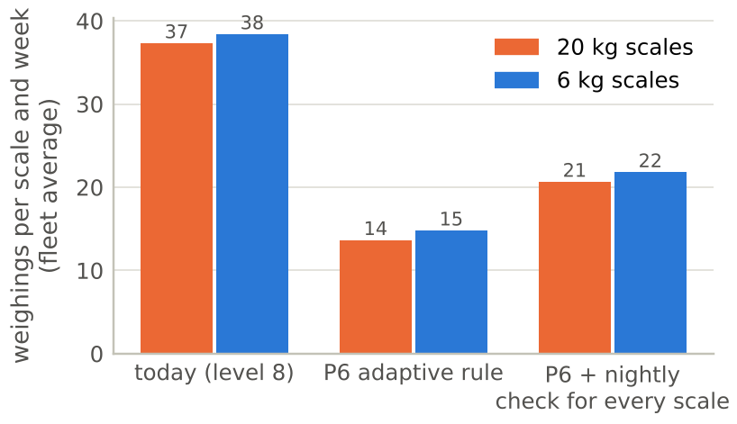

```{=typst}
#show table: set text(size: 8.5pt)
#show table: set par(justify: false)
#show figure.caption: set text(size: 9pt)
```



# Management summary

**Problem.** Every SmartBin Cloud scale weighs its bin when a vibration sensor wakes it up. A weighing draws about 3,000 times the sleep power and loads the radio network, the IoT cloud and ARIMS. A change the sensor sleeps through leaves a wrong stock level. At the factory default (sensitivity 8) the typical 20 kg scale wakes up empty 13.5 times a week and catches 1.5 real picks; the median TOO_MANY fraction is **0.92** (6 kg scales: 8.5 empty wake-ups, 3.0 picks, fraction **0.74**). Only **6%** of the 20 kg and **19%** of the 6 kg scales meet both Bossard targets.

**Approach.** 7.6 million weighings of 18,455 scales (March–June 2022) were cleaned with an explicit rule book and turned into one record per scale and sensitivity level. Every scale counts once, and 6 kg and 20 kg scales are analysed separately. During the period 7,846 scales were moved away from level 8, so the effect of the setting was measured on the *same* scales before and after their switch, against scales that stayed on 8 (difference-in-differences). The timing of every empty wake-up was compared with picks at other scales of the same site, and detection was measured per pick size. A simulation then compares seven sensitivity policies.

**Key findings.**

- **The problem is one-sided.** At level 8, 99% (20 kg) and 98% (6 kg) of the scales meet the TOO_FEW target, but only 6% and 20% meet the TOO_MANY target.
- **Empty wake-ups follow people working nearby.** At level 8, 60% of the empty wake-ups of 20 kg scales occur within ±14 seconds of a real pick at another scale of the same site; in a control window one minute later the share is only 22%. Beyond chance, **48%** (6 kg: **42%**) of the empty wake-ups are linked to picking at the same site at the same moment. The other half remains unexplained.
- **The TOO_MANY fraction is the wrong compass.** Moving the same scales from level 8 to level 1 removes 97% (20 kg) and 98% (6 kg) of their empty wake-ups, but lowers the fraction only by 0.23 and 0.20, because the sensor also stops catching real picks (−90% and −96%). On level 1, half or more of all real changes are missed, and 11–17% of the scales never wake up at all.
- **Rarely used bins look worse, and 20 kg bins are used less.** At the same setting the least-used fifth of the 20 kg bins has a fraction of 1.00, the most-used fifth 0.63. A typical 20 kg bin is picked half as often as a 6 kg bin (1.5 vs 3.0 caught picks per week); this alone explains roughly two thirds of the gap in the fraction between the scale types.
- **Every scale has a blind zone.** A change below about **23 g (20 kg)** or **5 g (6 kg)** is mostly classed as "no change": such a pick is labelled TOO_MANY when the sensor wakes up and is never reported when it does not. At level 8, picks of 20 g and more are detected in at least 95% of cases on both scale types.
- **6 kg and 20 kg scales are two different instruments.** The same step from level 8 to 6 removes 56% of the empty wake-ups on 20 kg scales but 79% on 6 kg scales, and costs 3 vs. 6 percentage points of missed changes.
- **Sensitivity 3 behaves like a defect, not a setting.** Most level-3 wake-ups come in a 90-second loop, a third of them at night. The typical level-3 scale weighs 3–8 times as often as on level 8, and the scales caught in the loop push the average to about 150 wake-ups per scale and day.
- **The site shows the largest differences.** Sites differ strongly and reproducibly: the middle 80% of the 20 kg sites range from 0.61 to 0.97 in TOO_MANY fraction.

**Recommendations and effect.**

| Measure | Scope | Effect |
|------------------------------------------------------------|------------------|-----------------------------|
| Repair the sensitivity-3 loop (firmware or configuration) | 907 scales, at least 17.5% of all weighings | on average about 150 → 11 wake-ups per scale and day |
| Set the sensitivity per scale with an adaptive rule (P6), separately for 6 kg and 20 kg | all scales | weighings −63% (20 kg) / −61% (6 kg); median missed changes 11% / 12% |
| Add a nightly check weighing for every scale | all scales | every missed change visible within 24 h; weighings still −45% / −43% |
| Steer with KPI 2.0 (TOO_MANY per week ≤ 7, missed changes ≤ 10%) instead of the fraction | reporting | the KPI rewards a correct setting, not a busy bin |
| Put small parts (< 25 g per pick) on 6 kg scales | bin layout | picks below about 23 g are largely invisible to a 20 kg scale |
| Test rack decoupling on site; tune high-activity sites first | sites | targets the activity behind about half of the empty wake-ups |

With the adaptive rule the 110,000 installed scales would perform about **2.6 million fewer weighings per week** (about 24 per scale and week), at a median of 11–12% missed changes instead of 3–5% in the simulated status quo. In the simulation, no policy brings the typical scale to Bossard's TOO_MANY target of 0.5 (best median: 0.67 for 20 kg and 0.59 for 6 kg scales). The setting can only trade empty wake-ups against missed changes; about half of the empty wake-ups are linked to people working nearby, and the other half is still unexplained.

# Situation, goal and data

Bossard's SmartBin Cloud places a weighing scale under each bin; the stock level flows into ARIMS, which triggers replenishment automatically. About 110,000 scales were installed by March 2025. The scales run on batteries that should last at least five years. A vibration sensor wakes a scale up when someone touches the bin; the **sensitivity setting (1–10)** decides at which vibration intensity this happens. Two further settings (minimum wait time, measurement delay) are out of scope.

Bossard measures two KPIs per scale: the **TOO_MANY fraction** (empty automatic weighings / all automatic weighings, target ≤ 0.5, alarm > 0.8) and **TOO_FEW per week** (changes the sensor missed, target ≤ 2). **Goal:** answer the three case questions – which parameters have no or only marginal influence, which do influence the result, and how the sensitivity should be set.

**Dataset.** Three files were provided: `measurements.csv` with 7,596,224 weighings of 18,455 scales from 1 March to 20 June 2022, `scale_metadata.csv` (scale type, box, site, item weight) and `scale_preprocessing.csv` (D ONE flags). Each weighing is labelled by who triggered it and whether the weight changed (counts after removing 5,738 duplicate or broken rows; 9,886 rows carry no label):

| Triggered by | Weight changed? | Label | Meaning | Weighings |
|------------------------------|--------------|------------|------------------------|----------:|
| vibration sensor (automatic) | yes | OK | real pick caught | 1,667,762 |
| vibration sensor (automatic) | no | TOO_MANY | empty wake-up | 5,411,757 |
| person or 24 h idle check (manual) | no | OK | nothing missed | 390,225 |
| person or 24 h idle check (manual) | yes | TOO_FEW | change the sensor missed | 110,856 |

76% of all automatic weighings are empty wake-ups. Until the end of March almost every scale ran on the factory default of 8; from April onwards, a large part of the fleet was moved to other levels (@fig-design). This switch is the natural experiment behind the causal estimates in Section 5. It was not randomised, so each switched scale is compared with itself before the switch and with scales that stayed on level 8.

{#fig-design width=100%}

# Data preparation

**A rule book in two stages.** Stage A *deletes* rows that cannot be used anywhere: 5,733 duplicate copies (same scale, same millisecond) and 5 physically impossible weights (144 kg to 50 t – exactly the rows D ONE marked as "invalid weight"). Stage B *flags* rows that are unsuitable for the KPI analysis but keeps them, because they are still real weighings: they are needed to compute the weight change of the next weighing and as neighbouring picks in the timing analysis (@fig-cleaning). In total, 5.26 million rows (69%) enter the KPI analysis; every excluded row is exported with its reason.

{#fig-cleaning width=100%}

Four checks shaped the rules:

- **Duplicates are not all identical.** In 4,199 of 5,499 duplicate groups all copies carry the same label. In the other 1,300 they carry *different* labels (OK and TOO_FEW, or OK and TOO_MANY); one copy is kept for the weight chain, but its outcome is treated as unknown.
- **D ONE's "relevant section" flag is correct.** The rule *at least 20 weighings over at least 5 days* was re-checked on all of about 58,700 sections and holds for 100% of them. Excluded periods have a median of 9 weighings over 4.8 days – too short for a weekly KPI.
- **Missing configuration values behave like the standard.** Rows with an empty minimum wait time show a similar TOO_MANY fraction at level 8 as standard rows (0.79 vs. 0.83 for 20 kg, 0.69 vs. 0.69 for 6 kg) and are kept; only the 0.8% of rows with an explicitly different setting are excluded.
- **Scale type and site are missing for 985 scales**, which therefore cannot be assigned to the 6 kg or 20 kg analysis.

**Unit of analysis: one scale on one sensitivity level.** KPIs are computed per scale and then summarised with the median ("typical scale"), so that every scale counts once. Pooling all weighings would let the noisiest scales dominate: scales on level 3 are 3% of the scale records but produce 19% (20 kg) and 23% (6 kg) of all automatic weighings.

**How missed changes are found.** TOO_FEW can only come from a manual weighing. About 85% of the manual weighings come at least 24 hours after the previous weighing, and 73% of these fall into two two-hour windows of the day (@fig-check). This points to a scheduled job that weighs every scale that has been idle for 24 hours; these checks find 91% of all TOO_FEW. The gap to the previous weighing is 26 to 49 hours (5th to 95th percentile). Two consequences follow. First, a scale cannot produce more than about one TOO_FEW per day, and a missed pick that is followed by an automatic weighing is labelled OK – **TOO_FEW is a lower bound of the misses**. Second, a missed change stays invisible for up to two days if nobody touches the bin.

{#fig-check width=100%}

# Data analysis

## Today: a one-sided problem

At level 8, the TOO_MANY fraction of most scales is far above the target, while almost every scale meets the TOO_FEW target (@fig-onesided). On 20 kg scales the median fraction is 0.92 and 71% of the scales are above Bossard's alarm level of 0.8; on 6 kg scales the median is 0.74. The typical scale reports only 0.12 (20 kg) or 0.36 (6 kg) missed changes per week. The question is therefore not how to balance two equally violated targets, but **how far the sensitivity can be lowered before real changes are missed**.

{#fig-onesided width=100%}

## How consistent is each sensitivity level?

@fig-classes groups the scales of each level into four classes of the TOO_MANY fraction. Lower levels move scales from the dark red class into the blue classes, but no level reaches a majority within the target: at the best level (1), 31% of the 20 kg and 45% of the 6 kg scales are at or below 0.5 – and 11% and 17% of the scales on level 1 never woke up at all (grey). The spread within every level is wide: the setting explains less than where and how a bin is used. *Note:* this view compares different scales and periods; the causal effect of the setting follows in Section 5.

{#fig-classes width=100%}

## The fraction is the wrong compass

The TOO_MANY fraction divides two numbers that both depend on the setting. @fig-counts shows them separately for the typical scale on each level. From level 8 to level 1, empty wake-ups fall from 13.5 to 0.55 per week on 20 kg scales (−96%) and from 8.5 to 0.17 on 6 kg scales (−98%). Real picks caught fall almost as fast (1.5 → 0.26 and 3.0 → 0.14 per week), because a less sensitive sensor also sleeps through real picks. The fraction therefore moves far less (0.92 → 0.70 and 0.74 → 0.50). This view compares different scales, but the same pattern holds for the same scales before and after their switch (Section 5): from level 8 to level 1, empty wake-ups fall by 97% and 98%, caught picks by 90% and 96%, and the fraction only by 0.23 and 0.20. A scale on level 1 has a "good" fraction mainly because its sensor is practically switched off.

{#fig-counts width=100%}

## Rarely used bins look worse – and 20 kg bins are used less

At the same setting, the fraction is strongly related to how often a bin is used (@fig-usage, left). The least-used fifth of the 20 kg bins has a median fraction of 1.00, the most-used fifth 0.63 (Spearman correlation between real picks per week and fraction: −0.82; 6 kg: −0.67). A rarely used bin has few real weighings in the denominator, so every empty wake-up weighs more. Usage also explains a large part of the difference between the scale types (@fig-usage, right). The typical 20 kg bin is picked only 1.5 times a week (6 kg: 3.0) and wakes up empty 13.5 times (6 kg: 8.5). With the lower usage of a 20 kg bin alone, a typical 6 kg bin would have a fraction of about 0.85 instead of 0.74 – roughly two thirds of the gap between the scale types. The fraction therefore **penalises slow-moving parts**.

{#fig-usage width=100%}

## Empty wake-ups follow people working nearby

**Thesis.** An empty wake-up is caused by activity at the rack: a worker who picks parts from one bin shakes the rack or touches the neighbouring bins, and their sensors wake up although nothing was taken from them.

**Test.** For every empty wake-up, we looked for real picks (automatic OK weighings) at *other* scales of the same site within a time window around it. The data contain no rack positions, so the whole site is the neighbourhood. If wake-ups and picks were unrelated, picks would be spread evenly over time. Instead, they pile up sharply at the moment of the empty wake-up (@fig-coupling, left and centre): the rate of picks at other scales jumps from about 1 per minute (chance level) to about 9 per minute. The peak is about ±14 seconds wide; both sensors use the same 30-second measurement delay, so the peak sits at zero.

**Result.** At level 8, 60% of the empty wake-ups of 20 kg scales have a pick at another scale of the site within ±14 s. In an equally wide control window 60–88 s later, the same holds for only 22% – that is the chance level of a busy site (@fig-coupling, right). The share that is explained beyond chance is

$$a = \frac{p_\text{near} - p_\text{chance}}{1 - p_\text{chance}} = \frac{0.596 - 0.221}{1 - 0.221} = 0.48$$

for 20 kg scales and 0.42 for 6 kg scales: **almost half of the empty wake-ups are linked to picking at the same site at the same moment**. A scale's own "echo" (a wake-up within 5 minutes after its own pick) explains only 1–3%. The remaining 51% (20 kg) and 55% (6 kg) have no such link and remain unexplained.

**What it does and does not show.** The same peak appears around *real* picks (grey lines; 54% and 53% beyond chance): people pick several bins in a row. The data therefore show that empty wake-ups are **coupled to human activity at the site**, but they cannot separate vibration travelling through the rack from a worker touching the bin, or from a real pick too small to count (next section). A short on-site test with an accelerometer or a damping pad would settle this. The coupling also does not explain why some sites are worse than others (it accounts for only 7% and 14% of the differences between sites).

{#fig-coupling width=100%}

## The scale's blind zone and the efficient range

The cloud labels a weighing as "changed" only if the weight changed by more than a significance threshold. The threshold is not documented; it was estimated from the data as the lower end of the changes reported as missed (5th percentile of TOO_FEW pick sizes): **about 23 g on 20 kg scales and 5 g on 6 kg scales**. It is not a sharp line: about 2% (20 kg) and 5% (6 kg) of the caught picks are smaller. @fig-blind shows the weight change behind each label. Most empty wake-ups really are empty (76% of them show at most 2 g on 20 kg scales, 88% on 6 kg scales). But 24% (20 kg) and 12% (6 kg) show a change of more than 2 g that the scale still classed as "no change" – part of these are probably single small parts that the scale does not count. Below the threshold a pick is largely invisible: it is labelled TOO_MANY when the sensor wakes up and never reported when it does not.

{#fig-blind width=100%}

Above the threshold, detection depends on the pick size and the level (@fig-zones). A pick counts as detected when the sensor wakes up for it (automatic OK) and as missed when only a later manual weighing finds the change (TOO_FEW).

{#fig-zones width=100%}

This gives a simple rule for each scale type – **the efficient range** (lowest level that still detects at least 95% of the picks of a given size):

| Typical pick size | 6 kg scale | 20 kg scale |
|--------------------------|-------------------------------------------|-------------------------------------|
| below 5 g | below the threshold | below the threshold |
| 5–20 g | no level reaches 95% (levels 7–8: 92.4–94.8%) | below the threshold (≈ 23 g) |
| 20–50 g | level 7 | level 8 |
| 50–100 g | level 7 | level 7 |
| 100–200 g | level 7 | level 6 |
| 200–500 g | level 6 | level 6 |
| above 500 g | level 6 | level 7 |

Levels 1–5 do not reach 95% for any pick size: they detect only 30–93% of the picks on 6 kg and 43–89% on 20 kg scales. Two consequences follow: small parts with picks below about 25 g belong on 6 kg scales, and no level below 6 is acceptable for any pick size.

## Sites differ strongly and reproducibly

The site shows the largest differences (@fig-location). Among 20 kg scales on level 8, the median TOO_MANY fraction of the sites ranges from 0.61 to 0.97 (10th to 90th percentile; 6 kg: 0.48–0.92). The differences are not chance: 42% (20 kg) and 40% (6 kg) of the variation between scales lies between sites (intraclass correlation), a permutation test with 999 shuffles gives p = 0.001, and two random halves of each site agree closely (split-half r = 0.76 and 0.85). The effect remains after removing differences in usage (ICC 0.44 and 0.40). Possible reasons are rack construction, shelf positions, nearby machines and the way people work; the data contain only the site, not the rack.

{#fig-location width=100%}

## Which parameters matter

@fig-params compares the parameters by a simple measure: how far apart are the best and the worst group? To avoid mixing in the setting, all parameters except the sensitivity are compared on level 8 only. For sites, the 10th and 90th percentile of the site medians are used, so that a few small sites do not dominate.

{#fig-params width=100%}

On 20 kg scales the site moves the fraction most (0.34), followed by the sensitivity level (0.25) and the fill level of the box (0.16); box type (0.11) and item weight (0.08) come last. On 6 kg scales the site also leads (0.41), followed by the fill level (0.27), the box type (0.26, only two common types) and the sensitivity (0.24). The fill-level effect is much smaller when the *same* scale changes its fill level: −0.045 (20 kg) and −0.027 (6 kg) when the box gets heavier. The larger cross-sectional difference probably reflects that nearly empty boxes are also rarely used boxes. D ONE's subset `relevant_for_weight_analysis` shows −0.25 and −0.12, because it was selected on scales where "something changes" – that is, on the outcome. Item weight and box type matter little on 20 kg scales; on 6 kg scales only two box types are common, and they are concentrated on different sites.

| Case question | Answer |
|----------------------------------------|----------------------------------------------------------------|
| 1. No or only marginal influence | box type and item weight on 20 kg scales (1–2% of the variance each); fill level within the same scale (−0.03 to −0.05) |
| 2. Influence on the result | site (largest); sensitivity (causal, Section 5); item weight and usage, especially on 6 kg scales |
| 3. How to set the sensitivity | per scale with an adaptive rule, separately for both scale types (Section 6) |

A Shapley decomposition of the explained variance (Appendix B) also puts the site first, but gives the sensitivity only 1.5% of the variance (3.4% of the explained part). This does not mean the knob is weak: most of the data come from level 8, where almost every scale ran in March, so the observed differences between scales are mostly not differences in the setting. Its real strength is measured in the next section.

# The sensitivity knob

## Same scale, before and after the switch

For each of the 7,846 switched scales, the KPIs after the switch were compared with its own KPIs on level 8. The change in a balanced group of scales that stayed on level 8 over the same weeks was subtracted, which removes calendar effects (difference-in-differences). Counts per week were compared with a fixed-effects Poisson model; intervals are 95% bootstrap intervals over scales.

{#fig-knob width=100%}

| From level 8 to … | 7 | 6 | 5 | 4 | 2 | 1 |
|------------------------------------|---------:|---------:|--------:|--------:|--------:|--------:|
| 20 kg: empty wake-ups per week | −59% | −56% | −86% | −95% | −92% | −97% |
| 20 kg: missed changes (pp) | +1 | +3 | +9 | +23 | +21 | +50 |
| 20 kg: TOO_MANY fraction | −0.05 | −0.07 | −0.10 | −0.15 | −0.12 | −0.23 |
| 6 kg: empty wake-ups per week | −68% | −79% | −90% | −95% | −93% | −98% |
| 6 kg: missed changes (pp) | +3 | +6 | +20 | +38 | +30 | +62 |
| 6 kg: TOO_MANY fraction | −0.05 | −0.08 | −0.11 | −0.16 | −0.15 | −0.20 |
| Scales (20 kg / 6 kg) | 639 / 1,116 | 639 / 1,134 | 529 / 954 | 453 / 805 | 464 / 906 | 372 / 735 |

The knob is powerful: the first steps (8 → 7 → 6) remove an estimated 56–79% of the empty wake-ups at a cost of 1–6 percentage points of missed changes. The 20 kg estimates are less precise (8 → 6: −24% to −67%, 95% interval). Below level 6, the price in missed changes rises steeply. Levels 2 and 4 are almost equivalent.

## Two different instruments

The same nominal level does not mean the same thing on both scale types:

| | 20 kg | 6 kg |
|--------------------------------------------------------|---------------:|---------------:|
| Significance threshold | ≈ 23 g | ≈ 5 g |
| Caught picks per week (typical scale, level 8) | 1.5 | 3.0 |
| Empty wake-ups per week (typical scale, level 8) | 13.5 | 8.5 |
| Level 8 → 6: empty wake-ups | −56% | −79% |
| Level 8 → 6: missed changes | +3 pp | +6 pp |
| Second-largest share of explained variance (Appendix B) | fill level | item weight |

The 6 kg scales react more strongly to the knob in *both* directions. Whether level *n* stands for the same vibration threshold on both hardware versions is not documented. **Recommendation: calibrate, set and monitor the sensitivity separately for each scale type; never apply one number to both.**

## Sensitivity 3 behaves like a defect, not a setting

The case description advises ignoring level 3. The data show why (@fig-sens3). Together, the 907 scales that ran on level 3 woke up 146 (20 kg) and 162 (6 kg) times per scale and day on average – 13 times as often as the same scales on level 8. The typical (median) level-3 scale was less extreme, with 17 (20 kg) and 32 (6 kg) weighings a day, 3 to 8 times its own level-8 rate: a minority of scales caught in a loop produces most of the wake-ups. The median gap between two wake-ups was 90 seconds, which equals the minimum wait time (60 s) plus the measurement delay (30 s). 73–75% of the wake-ups followed the previous one within 2 minutes, and a third came at night. This is the signature of a trigger loop, not of a sensitivity level. Part of the difference is selection: these scales were already busier on level 8 (5.1 vs. 2.5 weighings per day on 20 kg scales). Level-3 rows make up at least 17.5% of all rows in the data set.

{#fig-sens3 width=100%}

# Recommendation and effect

## KPI 2.0

Bossard's fraction punishes rarely used bins (Section 4.4), and the TOO_FEW target is met by almost every scale even when it misses many changes: on level 1, where half or more of the real changes are missed, 98% (20 kg) and 93% (6 kg) of the scales still meet it. We therefore propose to measure the load and the service level directly:

| KPI 2.0 | Target | Why |
|----------------------------------------------------------|----------|----------------------------------------------------|
| TOO_MANY per week (absolute) | ≤ 7 | battery, radio and cloud pay per weighing, not per ratio |
| Share of real changes missed: TOO_FEW / (caught picks + TOO_FEW) | ≤ 10% | the service the customer actually receives |
| TOO_FEW per week | ≤ 2 | Bossard's own floor, kept |

## Policies compared

A simulation applies seven policies to every scale. Each scale keeps its own behaviour on level 8 (its rates of empty wake-ups, picks and misses), and the causal rate ratios of Section 5 translate this behaviour to any other level. The policies are: **P0** today (level 8); **P1** the best single level for Bossard's KPIs (20 kg: 4, 6 kg: 2); **P2** a table by pick-size class; **P3** an adaptive rule for Bossard's KPIs; **P4** the best level per scale in hindsight (oracle); **P5** the best single level for KPI 2.0 (20 kg: 7, 6 kg: 6); and **P6** an adaptive rule for KPI 2.0. The adaptive rule starts every scale on level 8 and reviews it every two weeks. It goes one level *more* sensitive if the scale missed more than 10% of its changes or had more than 2 TOO_FEW per week, and one level *less* sensitive if it woke up empty more than 7 times a week while missing at most 5%.

{#fig-policies width=100%}

| Policy | Scale | In target (Bossard) | In target (KPI 2.0) | Missed changes (median) | Weighings vs. today | Battery life |
|-----------------------------|--------|-----------:|-----------:|-----------:|-----------:|----------:|
| P0 today (simulated) | 20 kg | 2% | 4% | 3% | 0% | 0% |
| P1 one level for Bossard's KPIs | 20 kg | 19% | 7% | 38% | −83% | +15% |
| P5 one level for KPI 2.0 | 20 kg | 8% | 20% | 9% | −52% | +9% |
| **P6 adaptive rule for KPI 2.0** | **20 kg** | 7% | **26%** | **11%** | **−63%** | +8% |
| P0 today (simulated) | 6 kg | 9% | 7% | 5% | 0% | 0% |
| P1 one level for Bossard's KPIs | 6 kg | 26% | 4% | 46% | −84% | +12% |
| P5 one level for KPI 2.0 | 6 kg | 21% | 12% | 19% | −71% | +10% |
| **P6 adaptive rule for KPI 2.0** | **6 kg** | 12% | **19%** | **12%** | **−61%** | +5% |

The policies that optimise Bossard's KPIs (P1–P4) reach the highest share "in target" but miss 38–53% of all real changes. They achieve the target by switching the sensor practically off. **P6 is the recommended policy**: it cuts the weighings by about 60% while the typical scale misses 11–12% of the changes. It adapts to the site and the usage of every bin without needing these as inputs.

The simulation is stricter than the observed data: in the simulated status quo only 2% (20 kg) and 9% (6 kg) of the scales are in target, against 6% and 19% observed (Section 4.1). The policies should therefore be compared with P0 rather than read as absolute shares. A back-test on the real switchers shows that the simulation is somewhat optimistic (in 11 of 12 groups it predicts a lower TOO_MANY fraction than observed, by up to 0.11) and predicts individual scales only roughly (correlation 0.31–0.68 between predicted and observed fraction). The rule should therefore be piloted on a few sites first. The battery effect (+5% to +8%) is smaller than the drop in weighings, because the assumed sleep consumption dominates the energy budget.

## A nightly check as a safety net

A lower sensitivity misses more changes, and today a missed change can stay invisible for up to two days (Section 3). A check weighing every night for *every* scale would bound this delay at 24 hours and give ARIMS a reliable stock level each morning. It costs at most seven weighings per scale and week. Combined with P6, the scales would still perform 45% (20 kg) and 43% (6 kg) fewer weighings than today (@fig-safety).

{#fig-safety width=62%}

# General recommendations

1. **Repair the sensitivity-3 loop** and remove level 3 from the setting range until it is fixed. Level-3 rows make up at least 17.5% of all weighings in the data.
2. **Introduce the adaptive rule (P6), separately for 6 kg and 20 kg scales.** Start on level 8, review every two weeks, step down while empty wake-ups exceed 7 per week and misses stay at or below 5%, step up when misses exceed 10% or TOO_FEW exceeds 2 per week. Pilot it on a few sites first and compare against matched control sites.
3. **Never go below level 6 as a fixed setting.** Below 6, the scales miss 9 to 62 percentage points more of the real changes; level 1 practically switches the sensor off.
4. **Report KPI 2.0** (TOO_MANY per week, share of changes missed) next to Bossard's KPIs, and stop judging slow-moving bins by the fraction.
5. **Add a nightly check weighing** (or a 12-hour check for critical parts) so that every missed change becomes visible within a day.
6. **Use the efficient range when placing parts.** Parts picked in amounts below about 25 g belong on 6 kg scales; on 20 kg scales they are largely invisible.
7. **Test the rack hypothesis on site.** Run an on-site test at a site with many empty wake-ups (accelerometer, damping pads under the bins). Then tune high-activity sites first; the coupling analysis can rank them and infer groups of physically close scales.
8. **Clarify three facts with Bossard and the firmware team:** the exact rule and schedule of the idle check, the physical meaning of the sensitivity levels on both scale types, and the definition of the significance threshold.

# Limitations and outlook

The data are **observational**. The before/after design removes everything that is constant per scale as well as calendar effects, but cannot rule out events that happened only to switched scales at the moment of their switch. The figures in Section 4 compare different scales and periods and are descriptive. **TOO_FEW is a lower bound** of the misses (Section 3), so the true miss rates are somewhat higher than reported, for every policy alike. The **site** is the finest location in the data; racks were only inferred from timing. The **coupling analysis** links about half of the empty wake-ups to human activity nearby but cannot separate vibration through the rack from touching the bin or from picks below the threshold; the **other half remains unexplained**. The **idle-check rule** and the **significance threshold** were inferred from the data and should be confirmed by Bossard. The **battery effect** rests on an assumed consumption model (2 s per weighing at 3,000 times the sleep power). The data cover **one season** (March–June 2022). The **policy simulation** is stricter than the observed status quo, somewhat optimistic in the back-test and predicts individual scales only roughly; its numbers serve to compare policies, not as forecasts.

**Outlook:** a pilot of the adaptive rule with matched control sites, an on-site vibration test, a fix for level 3, and KPI 2.0 monitoring in a dashboard (a Power BI prototype exists). A next analysis step is to model the empty wake-ups per site and rack directly, using the inferred groups of neighbouring scales.



# Appendix {.unnumbered}

## A. Method details {.unnumbered}

- **KPIs per scale and level:** TOO_MANY fraction = TOO_MANY / automatic weighings; TOO_FEW per week = TOO_FEW / observed weeks; missed changes = TOO_FEW / (automatic OK + TOO_FEW). Periods with fewer than 20 weighings or less than 5 days are excluded (D ONE rule). "Typical scale" = median over scales.
- **Cleaning:** Stage A deletes duplicates (same scale and millisecond; the first copy is kept) and weights below 0 or above 100 kg. Stage B flags, in this order: conflicting duplicates, missing label, inconsistent label, missing sensitivity, explicitly non-standard minimum wait time or delay, missing scale metadata, short periods, level 3, and levels used by fewer than 30 scales of a type.
- **Difference-in-differences:** switched scales (level 8 before, one lower level after) against a balanced group of scales observed on level 8 from the first to the last weeks. Counts per week were modelled with a scale fixed-effects Poisson model (rate ratios); 95% intervals from 300 bootstrap samples over scales.
- **Coupling analysis:** sources are automatic OK weighings at other scales of the same site, targets are automatic weighings at level 8. The ±14 s window was taken from the width of the peak; the chance level is the share in an equally wide window 60–88 s after the target. The attributable share is $a = (p_\text{near} - p_\text{chance}) / (1 - p_\text{chance})$.
- **Significance threshold:** 5th percentile of the weight changes of TOO_FEW weighings per scale type.
- **Detection by pick size:** pick size = weight drop since the previous weighing (at most 7 days earlier). Detected = automatic OK, missed = TOO_FEW. Cells need at least 30 picks. A TOO_FEW can bundle several missed picks, which biases the rates in two opposite directions: fewer misses are counted (detection looks better), and they appear as larger picks (detection of large picks looks worse). A missed pick that is followed by an automatic weighing counts as detected.
- **Site effect:** intraclass correlation, permutation F-test (999 shuffles of site labels), split-half reliability (random halves of the scales of each site, 200 repetitions); usage adjustment by deciles of real picks per week.
- **Parameter spread:** median TOO_MANY fraction per group (at least 30 scales; sites at least 20), level 8 only except for the sensitivity; spread = best minus worst group, for sites the 10th–90th percentile of the site medians.
- **Policy simulation:** per scale, its level-8 rates (shrunk towards the scale-type mean with one pseudo-week) multiplied by the causal rate ratios; weighings and battery life with 2 s per weighing at 3,000 times the sleep power; back-test on the real switchers.
- **Reproducibility:** `python -m smartbin run` runs the pipeline; `python report/build_figures.py` builds the figures and the aggregated tables in `report/data/`; `quarto render report/report.qmd` builds this report.

## B. Additional figures {.unnumbered}

{width=100%}

{width=100%}
